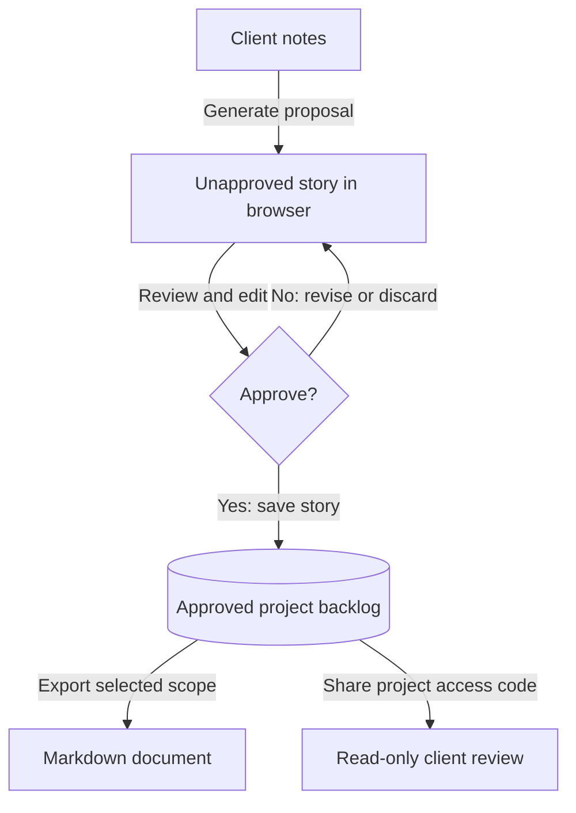

# Reviewer guide

Open Projects Hub is a master's final project exploring AI-assisted requirements preparation for freelancers. Its engineering contribution is a complete workflow: collect client notes, generate candidate user stories, review them, and publish an approved backlog with controlled client access.

The project demonstrates a working software design and implementation. Benefits such as time saved or better requirements quality remain evaluation goals; no measured user-study results are recorded in this repository.

The project presentation is available as [slides (PowerPoint)](https://oph-docs.alonsovndev.com/tfm/open-projects-hub-tfm.pptx).

## Recommended reading path

| Step | Review question | Evidence |
| --- | --- | --- |
| 1. Problem and objectives | What problem does the project address, and for whom? | [Overview](./overview.md), [personas](./user-personas.md), and [scope boundaries](./out-of-scope.md) |
| 2. Requirements | What must the system do? | [Feature requirements and quality targets](../01-requirements/README.md) |
| 3. Solution | How does the implementation support the workflow? | [Architecture](../03-architecture/core/architecture-solution-design.md), [database](../03-architecture/database/database-design.md), and [API contract](../03-architecture/api/api-contract.md) |
| 4. Trade-offs | Why were these technologies and constraints chosen? | [Decision log](../04-decisions/README.md), especially ADR-019 through ADR-024 |
| 5. Evidence and limitations | What can be verified, and what remains unproven? | [Evidence and limitations](./evidence-and-limitations.md) and [run guide](./run-the-system.md) |

## Worked example: a client's contact form

This fictional example describes software being planned **with** Open Projects Hub. The contact form is not a feature of Open Projects Hub. The text below is illustrative, manually reviewed content, not a recorded AI-provider response or a user-study result.

### 1. Capture the request

Create a client and a project for a small business website. In the refinement workspace, select that project and enter:

```text
Visitors should be able to send us an enquiry from our website.
Ask for their name, email address, and message. Notify us when it arrives.
Show visitors whether their enquiry was sent successfully.
```

### 2. Resolve ambiguity before approval

The freelancer must clarify what “notify us” means: an email, an in-app notification, or another channel? For this example, the client chooses email to the business mailbox. The freelancer also confirms that all three fields are required.

AI output is a proposal. The reviewer checks scope and wording rather than assuming the model inferred the client's intent correctly. A separate persisted ambiguity register is not part of the implemented refinement response.

### 3. Review the candidate story

**Title:** Send a website enquiry

**User story:** As a website visitor, I want to send an enquiry to the business, so that I can ask about its services.

**Acceptance criteria:**

1. A visitor enters a name, a valid email address, and a message before submitting.
2. A valid submission sends the enquiry to the business mailbox agreed with the client.
3. The visitor sees a success message after submission succeeds.
4. If submission fails, the form preserves the visitor's input and offers a retry.

These criteria are agreed requirements for the fictional website; they do not assert that the website has been built or tested.

### 4. Approve and publish

Edit the generated title, story, or criteria as needed, then approve the story. Before approval, the draft remains in the browser tab's session storage and does not appear in the server backlog, export, or Client Review Portal. Closing the tab loses unapproved drafts. Approval creates a persisted story ([ADR-019](../04-decisions/adr-019-no-persisted-draft-stories.md)).



*Approval is the persistence and publication boundary. AI generation alone does not publish requirements.*

Wide diagrams retain their text size. Swipe horizontally, or focus the diagram and use the arrow keys, to explore them on a smaller screen.

### 5. Export and review with the client

Open the project's backlog and export Markdown. Check the story and acceptance criteria against the agreed wording. The export includes project information and approved stories within the selected scope; local unapproved drafts are excluded.

For the fictional Cedar Studio project, the export has the following structure. The date, priority, and story points are illustrative; the real exporter uses the generation date and stored story values.

```markdown
# Cedar Studio Website — Requirements Backlog

**Project code:** PRJ-2026-001
**Generated on:** 2026-10-19
**Stories:** 1

---

## 1. Send a website enquiry

**Status:** todo · **Priority:** high
**Story points:** 3

As a website visitor, I want to send an enquiry to the business, so that I can ask about its services.

### Acceptance Criteria

- A visitor enters a name, a valid email address, and a message before submitting.
- A valid submission sends the enquiry to the business mailbox agreed with the client.
- The visitor sees a success message after submission succeeds.
- If submission fails, the form preserves the visitor's input and offers a retry.

---
```

Share the project's access code with the client. In Client Review, confirm the approved story is readable, no edit or export actions are offered, and internal workspace and user details are absent. Regenerating the code revokes access through the previous code ([ADR-020](../04-decisions/adr-020-client-review-by-access-code.md)).

## Demonstration checklist

- Create a client and project; verify the limit of three active projects per workspace.
- Generate candidate stories using an available provider or the documented local mock service.
- Edit a candidate story and verify it is absent from the backlog before approval.
- Approve the story and compare the backlog, Markdown export, and Client Review content.
- Regenerate the project access code and verify the old code returns not found.
- Check one failure case: invalid input, exhausted credits, or an unavailable provider.

Use synthetic data for demonstrations. Real provider calls require configured keys and may consume credits; follow the [run guide](./run-the-system.md) for environment setup. A mocked UI demonstration establishes presentation behavior, not external provider reliability or a complete backend transaction.

## How to interpret the remaining documentation

Requirements describe intended behavior and quality targets. The [evidence page](./evidence-and-limitations.md) identifies implementation support and validation gaps. Original ADRs and prototype screens record design history; their supersession notices explain how the current system differs.
