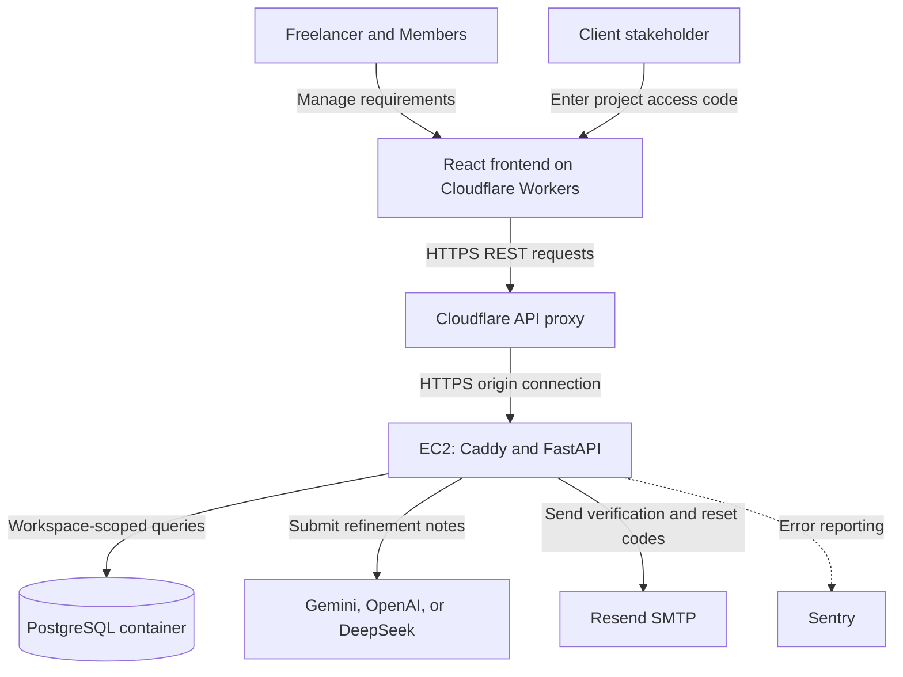
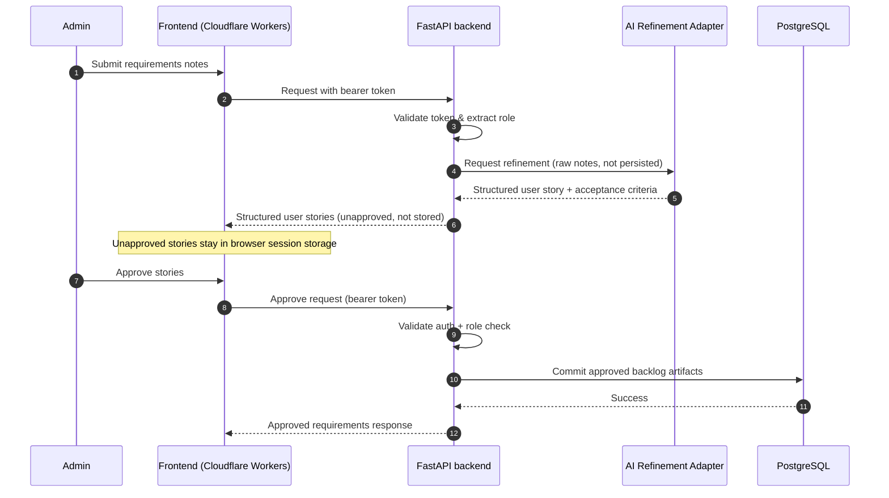

# Architecture Solution Design

| Attribute   | Value             |
| ----------- | ----------------- |
| **Project** | Open Projects Hub |
| **Version** | 1.1               |
| **Status**  | Accepted          |

## System Context

The Open Projects Hub must support AI-assisted requirement refinement, role-based collaboration (Admin/Member) with account-free client review, and secure project management for freelancers within MVP limits. Based on functional and non-functional requirements, the architecture must prioritize:

- rapid MVP delivery for a small team,
- strong maintainability through clear boundaries,
- secure-by-design access control and data handling,
- an explicit evolution path for future scale.

To satisfy these needs, the system is designed as separate frontend and backend projects with shared domain language and contracts.

## Architectural Approach

**Modular Monolith backend using Clean Architecture + DDD, with a separately deployed frontend application.**

The architecture prioritizes:

- **Rapid MVP delivery** with lower operational overhead than microservices
- **Strong domain boundaries** through explicit bounded contexts and dependency rules
- **Clean Architecture principles** keeping domain/application layers framework-agnostic
- **Evolutionary design** enabling future service extraction when scale demands it

For detailed rationale and alternatives considered, see [ADR-001: High-Level Architecture Pattern](../../04-decisions/adr-001-high-level-architecture.md).

### Key Design Principles

1. **Separation of concerns**: frontend and backend remain independent projects.
2. **Domain-centric design**: bounded contexts define module boundaries.
3. **Dependency inversion**: domain and application rules stay independent from frameworks.
4. **Security by design**: authorization and data-access rules are enforced at domain/application and data policy layers.
5. **Evolutionary architecture**: module seams support future extraction to services if growth demands it.

## Component Design

*The client path is public but access-code scoped. Team operations require authentication; AI and email services are external integrations.*

- **Frontend Project (Cloudflare Workers):** UI workflows for project management, AI refinement interaction, and read-only client review access; static assets served from Cloudflare's edge.
- **Backend Project (one EC2 host):** modular monolith organized by bounded contexts (clients, projects, stories, refinement, auth, workspaces, dashboard); a containerized FastAPI application with an integrated auth module, behind Caddy and the Cloudflare proxy.
- **Data Layer (PostgreSQL container):** transactional persistence; tenant isolation is enforced by workspace-scoped repository queries.

## Data Flow

## Integration Points

- **Frontend → backend:** HTTPS REST APIs under `/v1/*` with bearer-token authentication; the browser calls `https://api-oph.alonsovndev.com` directly (cross-origin, credentials allowed for `https://oph.alonsovndev.com`).
- **Backend → PostgreSQL:** persistence through backend-owned, workspace-scoped access patterns.
- **Authentication flow:** the backend auth module (internal bounded context) issues a 15-minute access token on `/v1/auth/login` and a refresh token in an HttpOnly cookie scoped to `/v1/auth`; the access token is validated on all protected routes.
- **External service integrations:**
  - Resend SMTP relay for registration verification and password-reset codes ([ADR-024](../../04-decisions/adr-024-email-delivery-with-resend.md)).
  - AI providers (Gemini, OpenAI, DeepSeek) for story refinement, using platform credits or a user's own encrypted key ([ADR-018](../../04-decisions/adr-018-user-api-key-encryption.md)).
  - Sentry error tracking in the backend and web app, active in production and off in local, dev and test configurations.

## Observability

Sized for a single host and near-zero traffic; see [Monitoring and Observability](../ops/monitoring-observability.md) for the full picture.

- **Health:** `/health/live` and `/health/ready` are checked on the host (they are not routed through Cloudflare).
- **Logs:** structured container logs, read with `docker compose logs` over SSM.
- **Errors:** Sentry in the API (`SENTRY_DSN`) and the web app (`VITE_SENTRY_DSN`).
- **Cost:** two AWS Budgets (a real-charge alert and a gross-usage alert).
- **Not deployed:** CloudWatch alarms, dashboards and uptime probes.

## Deployment Impact (GitHub Actions + AWS)

- **Pipeline stages:** quality gates on pull requests in each repository; on a `vX.Y.Z` tag the API workflow verifies the tag is on `main` and publishes the image to GHCR.
- **Deployment strategy:**
  - Frontend: Cloudflare Workers builds and serves the Vite output.
  - Backend: an operator runs `scripts/deploy-release.sh <tag>`, which triggers the `ophub-prod-deploy` SSM document on the host to pull the image and restart the Compose stack. GitHub OIDC is not available in the AWS account ([ADR-023](../../04-decisions/adr-023-credits-account-us-east-2-manual-deploy.md)).
- **Rollback:** redeploy a schema-compatible previous tag with the same script; database migrations do not reverse automatically.
- **Migration strategy:** versioned Alembic migrations applied when the API container starts.
- **Environment management:** one deployed environment; secrets live in SSM Parameter Store and are written to the host by the deploy script.
- **Downtime:** the single API container restarts on each deploy, so a short interruption is expected.
- **Post-deploy verification:** the script smoke-tests the routing through Cloudflare; the authenticated flow (register, verify, log in, create a project) is checked by hand.

## Security Considerations

- Enforce role-based authorization for Admin and Member capabilities, and confine the public Client Review route to one project's approved stories.
- Apply least-privilege access across frontend, backend, and database access.
- Public and origin connections use HTTPS; internal Compose traffic uses the host network boundary.
- EBS/state encryption and application-level provider-key encryption protect stored data; Cloudflare Full mode does not validate the origin certificate.
- Prevent abuse with request validation, rate limiting, and secure session/token lifecycle controls.

## Scalability Considerations

- Keep the backend stateless apart from the database so it could be scaled out later; the deployed system is one host.
- Keep modules isolated so hotspots can be independently optimized or extracted later.
- Use database indexing and query discipline for requirements and project listing paths.
- Keep workflows synchronous and optimize critical paths before introducing additional infrastructure.
- The frontend scales independently through Cloudflare's edge.

## Trade-offs and Alternatives

- **Chosen now:** modular monolith with strict module boundaries for speed and manageable complexity.
- **Deferred:** microservices, since current scope/team size does not justify distributed-system overhead.
- **Risk:** module boundary erosion over time.  
  **Mitigation:** explicit architecture governance, ADR-driven decisions, and periodic boundary reviews.
- **Risk:** growth in AI-related workload could pressure synchronous APIs.  
  **Mitigation:** apply targeted query optimization, payload shaping, and selective module extraction.

## ADR Reference

- [ADR-001: High-Level Architecture](../../04-decisions/adr-001-high-level-architecture.md)
- [ADR-004: Database (PostgreSQL)](../../04-decisions/adr-004-database.md)
- [ADR-005: Authentication (Custom FastAPI Auth + JWT)](../../04-decisions/adr-005-authentication.md)
- [ADR-006: Deployment Platform (AWS)](../../04-decisions/adr-006-deployment-platform.md), superseded in part
- [ADR-021: Low-Cost Single-Host Deployment](../../04-decisions/adr-021-low-cost-single-host-deployment.md)
- [ADR-022: Cloudflare Edge](../../04-decisions/adr-022-cloudflare-edge-instead-of-cloudfront.md)
- [ADR-023: Credits Account and Manual Deploys](../../04-decisions/adr-023-credits-account-us-east-2-manual-deploy.md)
- [ADR-024: Email with Resend](../../04-decisions/adr-024-email-delivery-with-resend.md)
- [ADR-009: Monitoring and Observability](../../04-decisions/adr-009-monitoring-observability.md), amended

## Source References

- [Architecture Styles](./architecture-styles.md)
- [Technology Stack](./technology-stack.md)
- [Requirements](../../01-requirements/README.md)

---

**Last Updated**: 2026-10-19
