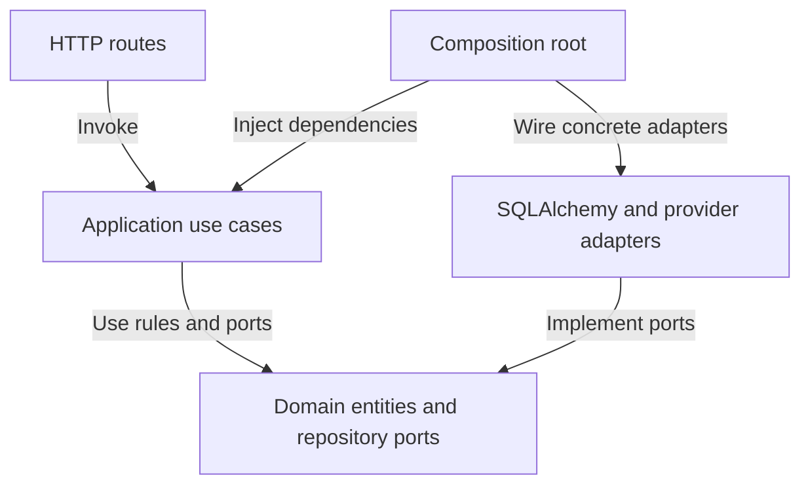

# Architecture styles

The backend uses a modular monolith with a separately deployed frontend. Feature-oriented modules keep domain and application logic close to the use cases they support, while the API remains one release artifact.

## Alternatives and rationale

| Style            | Benefit                                                       | Cost or risk                                                                               | Fit for this project                                      |
| ---------------- | ------------------------------------------------------------- | ------------------------------------------------------------------------------------------ | --------------------------------------------------------- |
| Layered monolith | Simple startup and deployment                                 | Feature responsibilities can spread across broad technical layers                          | Feasible, with discipline needed around feature ownership |
| Modular monolith | One deployable with feature boundaries and testable use cases | Boundaries still need review; a shared process and database couple failures and releases   | Selected for the requirements-planning MVP                |
| Microservices    | Independent scaling and releases                              | Network failures, distributed data, deployment coordination, and higher operating overhead | Deferred until a demonstrated need justifies the cost     |

The selection prioritizes a small operational footprint and inspectable code over independent service deployment. The original decision is [ADR-001](../../04-decisions/adr-001-high-level-architecture.md); its early schedule estimate was later revised in the [roadmap](../../02-planning/phased-roadmap.md).

## Module responsibilities

| Responsibility                                  | Implementation location                                     |
| ----------------------------------------------- | ----------------------------------------------------------- |
| Identity, sessions, and verification            | Auth and user features                                      |
| Workspace membership and boundaries             | Workspace feature, request context, and scoped repositories |
| Client and project lifecycle                    | Client and project features                                 |
| Candidate generation and provider configuration | Refinement and AI configuration features                    |
| Approved requirements and Markdown output       | Story and backlog features                                  |
| Client-facing review                            | Public access-code route and minimized project response     |

These are cooperating modules inside one API process, not separate services. Access control is enforced across route policies and workspace-scoped use cases/repositories rather than by a separately deployed authorization service.

## Dependency direction

_Arrows describe code dependencies. Runtime calls reach databases and external providers through the wired adapters._

This structure makes domain rules and application orchestration testable without a live provider or production database. It remains a design discipline to review, not proof that every file perfectly respects the intended boundaries.

## Trade-offs

- One backend release changes all modules together; there is no independent module rollout.
- A shared PostgreSQL database simplifies transactions but requires careful workspace scoping.
- Synchronous provider calls keep the workflow simple but expose refinement to provider latency and failures.
- The deployed single host has neither failover nor autoscaling. Modular code does not provide operational availability.

## Evolution strategy

Optimize measured bottlenecks before adding services. Extraction should be considered only when sustained throughput, fault isolation, independent release cadence, or a real ownership boundary warrants it.

A future service extraction would require an explicit data-ownership and failure-handling decision. No distributed queue, requirements microservice, or export service is committed by the current roadmap.

## Related documents

- [Solution design](./architecture-solution-design.md)
- [Technology stack](./technology-stack.md)
- [Evidence and limitations](../../00-context/evidence-and-limitations.md)
