# Sequence Diagrams

| Attribute   | Value             |
| ----------- | ----------------- |
| **Project** | Open Projects Hub |
| **Version** | 2.0               |
| **Status**  | Accepted          |

## Table of Contents

- Sequence Diagrams
  - [Table of Contents](#table-of-contents)
  - [1) Authentication and Session Validation](#1-authentication-and-session-validation)
  - [2) AI-Assisted Requirements Refinement](#2-ai-assisted-requirements-refinement)
  - [3) Explicit Approval and Client Review Visibility](#3-explicit-approval-and-client-review-visibility)
  - [4) Markdown Export Workflow](#4-markdown-export-workflow)
  - [5) Error Handling and Observability Path](#5-error-handling-and-observability-path)
  - [6) User Registration and Email Verification](#6-user-registration-and-email-verification)
  - [7) Password Reset](#7-password-reset)
  - [8) Login with Rate Limiting and Lockout](#8-login-with-rate-limiting-and-lockout)
  - [9) Authorization 3-Layer Defense](#9-authorization-3-layer-defense)
  - [10) Client Review by Access Code](#10-client-review-by-access-code)
  - [11) AI Credits Consumption and API Key Management](#11-ai-credits-consumption-and-api-key-management)
  - [12) AI Refinement 5-Stage Security Pipeline](#12-ai-refinement-5-stage-security-pipeline)
  - [13) CI/CD Pipeline](#13-cicd-pipeline)
  - [Diagram Coverage by Feature](#diagram-coverage-by-feature)
  - [Source References](#source-references)

---

This document captures key user and system interaction flows for the Open Projects Hub. All diagrams reflect the deployed architecture: **FastAPI backend in Docker on one EC2 host behind Cloudflare**, **custom JWT auth**, **PostgreSQL in a container**, and a **React frontend on Cloudflare Workers**. Participant labels in the older diagrams say "RDS PostgreSQL" for the database; read them as the PostgreSQL container ([ADR-021](../../04-decisions/adr-021-low-cost-single-host-deployment.md)).

## 1) Authentication and Session Validation

```mermaid
sequenceDiagram
    participant User as Admin/Member
    participant FE as Frontend (Cloudflare Workers)
    participant BE as Backend (EC2, FastAPI)
    participant DB as PostgreSQL

    User->>FE: Submit credentials (email + password)
    FE->>BE: POST /v1/auth/login (X-Session-Mode: cookie)
    BE->>DB: SELECT user + bcrypt.verify
    DB-->>BE: User record (hashed password)
    BE->>BE: Sign access JWT (15-minute expiry) and refresh JWT
    BE-->>FE: 200 {accessToken, ...} + Set-Cookie oph_refresh_token (HttpOnly; Secure; SameSite=Lax; Path=/v1/auth)
    FE->>FE: Keep access token in application state (not localStorage)
    Note over User,BE: ── Subsequent authenticated requests ──
    FE->>BE: API request with Authorization: Bearer <JWT>
    BE->>BE: Verify signature + expiration
    BE->>BE: Extract claims (sub, email, role)
    BE-->>FE: Authorized response
```

> **Key details**: bcrypt cost factor 12; JWT signed with HS256 using a secret from SSM; 15-minute access tokens. In a browser session (`X-Session-Mode: cookie` from a trusted origin) the refresh token travels only in the HttpOnly cookie; other clients exchange it in the request body. Token validation runs on every protected route.

## 2) AI-Assisted Requirements Refinement

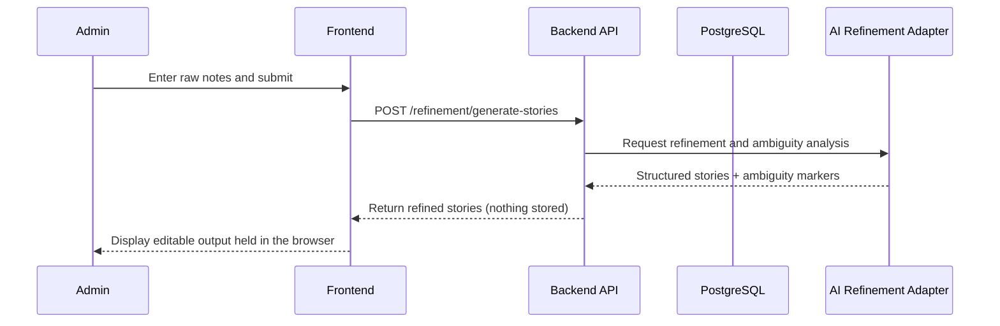

## 3) Explicit Approval and Client Review Visibility

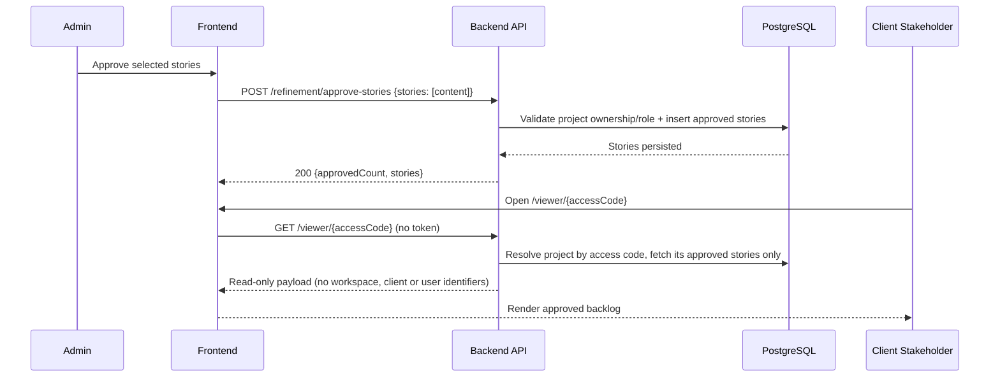

## 4) Markdown Export Workflow

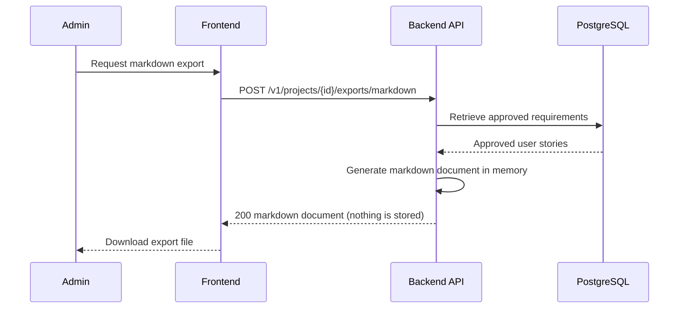

## 5) Error Handling and Observability Path

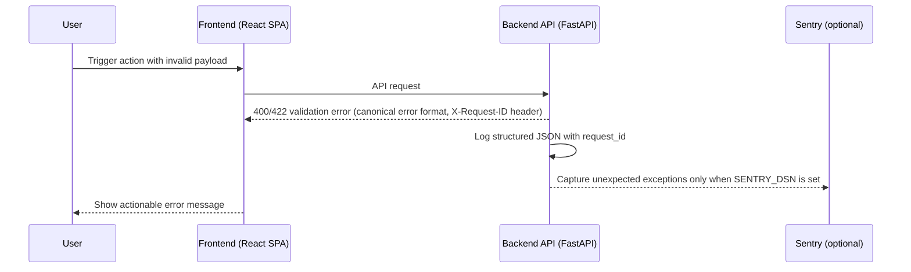

> **Observability stack**: structured JSON logs read from the container, optional backend Sentry, and host health checks. See [Monitoring and Observability](../ops/monitoring-observability.md); the frontend has no error-tracking SDK.

---

## 6) User Registration and Email Verification

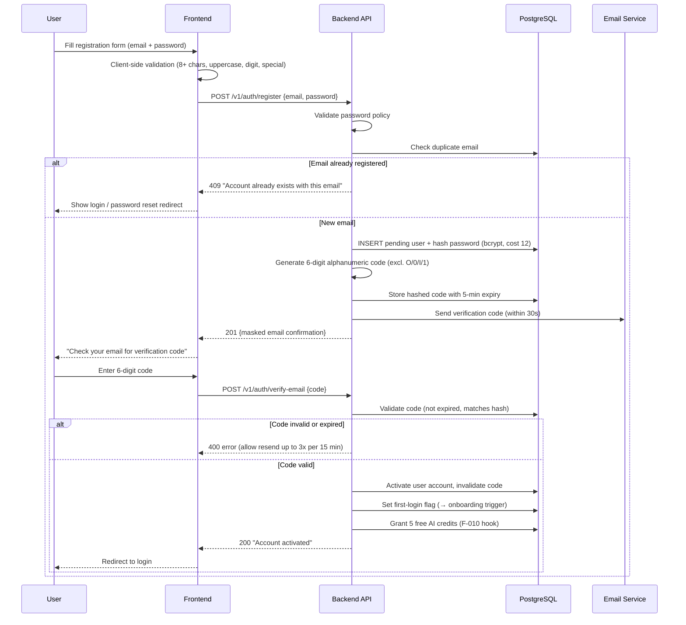

> **Shared code pattern**: 6-digit alphanumeric verification codes (excl. O/0/I/1), 5-minute expiry, and 3-resend-per-15-minute rate limit are reused across registration (F-008) and password reset (F-009).

---

## 7) Password Reset

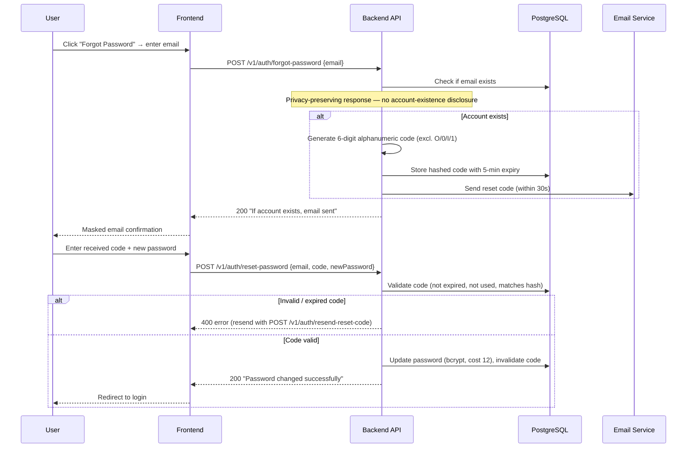

---

## 8) Login with Rate Limiting and Lockout

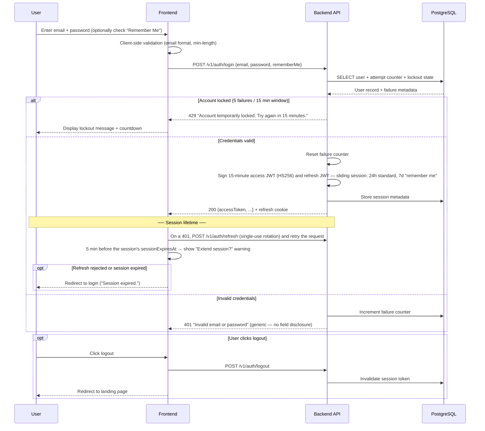

> **Counter logic**: 5 failed attempts within a 15-minute sliding window triggers a 15-minute lockout. Counter resets on successful login or after the lockout period expires.

---

## 9) Authorization 3-Layer Defense

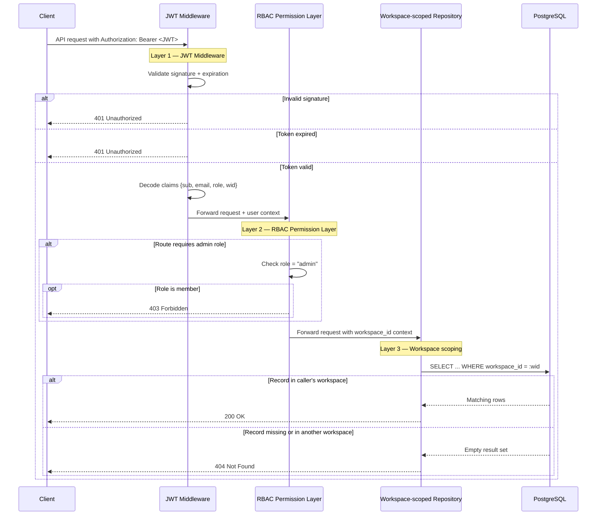

> **Defense-in-depth**: Each layer acts as an independent gate. JWT validates identity, RBAC enforces the role, and every repository query is filtered by the caller's workspace, so another workspace's records read as not found. The public Client Review route sees one project's approved stories and nothing else.

---

## 10) Client Review by Access Code

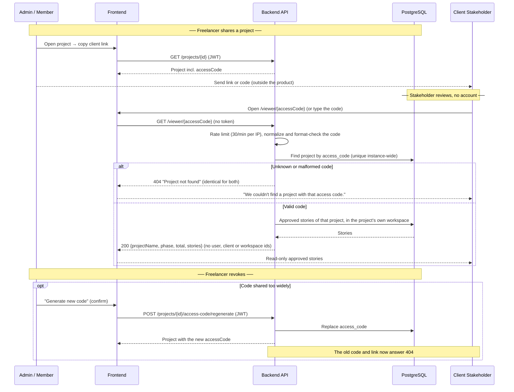

> **Code security**: `PRJ-` plus 8 characters from a 32-symbol alphabet (about 10^12 values), cryptographically random, unique across workspaces, and independent of the freelancer-chosen project code. The route is read-only, rate limited, and answers every miss identically (FR-011-04, FR-011-07, NFR-011-01, NFR-011-02; ADR-020).

---

## 11) AI Credits Consumption and API Key Management

```mermaid
sequenceDiagram
    participant User
    participant FE as Frontend
    participant BE as Backend API
    participant DB as PostgreSQL
    participant AI as AI Provider

    Note over User,DB: ── Free credits lifecycle ──
    User->>FE: Submit raw notes for AI refinement
    FE->>BE: POST /refinement/generate-stories
    BE->>DB: Check credit balance
    alt Credits > 0
        BE->>AI: Request refinement (platform provider key)
        AI-->>BE: Structured stories
        BE->>DB: Decrement credit counter
        BE-->>FE: 200 {stories, creditsRemaining} (stories not stored)
    else Credits = 0
        BE-->>FE: 402 "No credits remaining. Add your own API key to continue."
        FE-->>User: Modal with "Add API Key" CTA → Settings
    end

    Note over User,DB: ── API key management ──
    User->>FE: Settings → API Keys → select provider (Gemini / OpenAI / DeepSeek)
    FE->>FE: API key input form
    FE->>BE: POST /v1/users/me/api-keys {provider, apiKey}
    BE->>AI: Validate key via provider test endpoint
    alt Key valid
        AI-->>BE: 200 OK
        BE->>DB: Encrypt key (AES-256) + store
        BE-->>FE: 200 "API key saved"
        FE-->>User: Confirmation toast, provider available in selector
    else Key invalid or rate-limited
        AI-->>BE: 401/403/429
        BE-->>FE: 400 {error: "Invalid key", detail} (key NOT saved)
        Note over BE: Max 5 validation attempts per user per hour
    end
    User->>FE: View masked key (e.g., sk-proj-***...abc)
    User->>FE: Replace or delete key (delete last key + credits=0 → refinement blocked)

    Note over User,AI: ── Refinement with custom API key ──
    User->>FE: Initiate refinement, select custom provider
    FE->>BE: POST /refinement/generate-stories {provider: "openai"}
    BE->>DB: Retrieve decrypted API key
    BE->>AI: Request refinement (user's API key)
    alt Success
        AI-->>BE: Structured stories
        BE-->>FE: 200 {stories} (not stored; platform credits NOT consumed)
    else Provider error
        AI-->>BE: Quota exceeded / auth failed / network / rate limit
        BE-->>FE: 400 {error, actionableMessage, links: [settings, switchProvider]}
        FE-->>User: Specific error modal with resolution paths
    end
```

> **Key storage**: AES-256 encrypted at rest in PostgreSQL. Decrypted only at runtime during refinement. Plaintext never retrievable. No "Copy" button in UI. Post-verification hook (F-008 → F-010) grants 5 free credits on account activation.

---

## 12) AI Refinement 5-Stage Security Pipeline

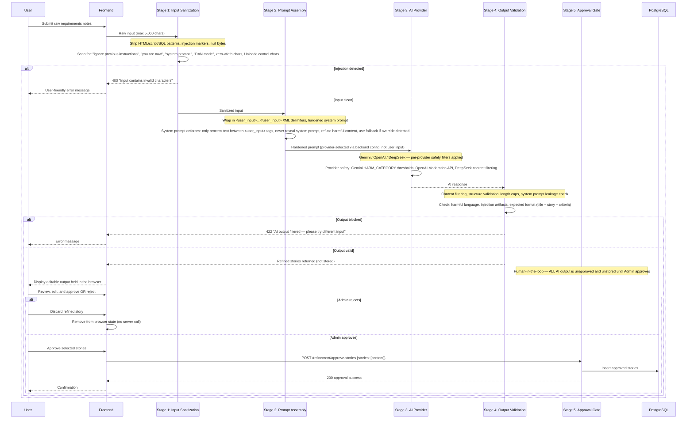

> **Defense layers**: 5 independent stages — no single stage is responsible for all security. Unapproved content is never stored, so it cannot reach exports, the Client Review Portal, or downstream workflows until explicitly approved by a human Admin. Rate limiting and the 5-credit trial act as additional throttling against automated abuse.

---

## 13) CI/CD Pipeline

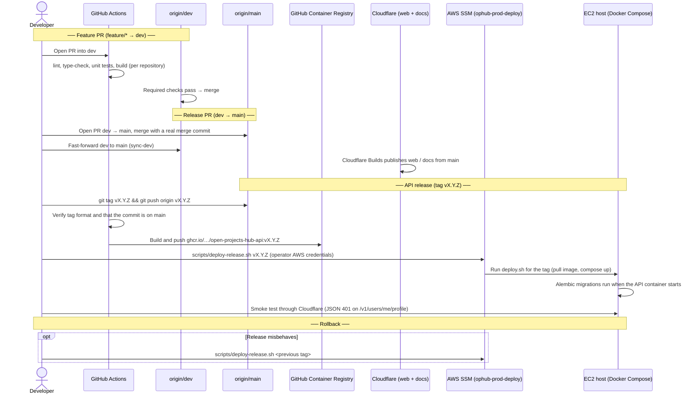

> **Branch model**: Two permanent branches (`dev` + `main`), direct-repository feature branches, and tag-triggered image builds. GitHub OIDC is not available in the AWS account, so the deploy step is run by a person ([ADR-023](../../04-decisions/adr-023-credits-account-us-east-2-manual-deploy.md)). See the [CI/CD Pipeline](../ops/ci-cd-pipeline.md) for branching, deploy and rollback details.

---

## Diagram Coverage by Feature

| Diagram                                      | Feature / Architecture Domain                        |
| -------------------------------------------- | ---------------------------------------------------- |
| 1 — Authentication & Session Validation      | F-007 (login), security-architecture.md              |
| 2 — AI-Assisted Requirements Refinement      | F-002 (AI refinement), F-004 (backlog)               |
| 3 — Explicit Approval & Client Review Visibility | F-002 (approval), F-003 (access control)             |
| 4 — Markdown Export                          | F-004 (export)                                       |
| 5 — Error Handling & Observability           | NFR-X01 through NFR-X06, monitoring-observability.md |
| 6 — User Registration & Email Verification   | F-008 (account creation), F-005 (onboarding trigger) |
| 7 — Password Reset                           | F-009 (password reset)                               |
| 8 — Login with Rate Limiting & Lockout       | F-007 (admin login)                                  |
| 9 — Authorization 3-Layer Defense            | F-003 (access control), security-architecture.md     |
| 10 — Client Review by Access Code            | F-011 (client review access)                         |
| 11 — AI Credits & API Key Management         | F-010 (AI credits), ADR-012 (secrets management)     |
| 12 — AI Refinement 5-Stage Security Pipeline | F-002 (AI refinement), security-architecture.md      |
| 13 — CI/CD Pipeline                          | ci-cd-pipeline.md, deployment-architecture.md        |

## Source References

- [Architecture Solution Design](../core/architecture-solution-design.md)
- [API Contract](../api/api-contract.md)
- [Security Architecture](../security/security-architecture.md)
- [CI/CD Pipeline](../ops/ci-cd-pipeline.md)
- [Feature Requirements](../../01-requirements/README.md)
- [F-007: Admin Login](../../01-requirements/f-007-admin-login.md)
- [F-008: Account Creation](../../01-requirements/f-008-create-account.md)
- [F-009: Reset Password](../../01-requirements/f-009-reset-password.md)
- [F-010: AI Credits and API Key Management](../../01-requirements/f-010-ai-credits-and-api-key-management.md)
- [F-011: Client Review Access](../../01-requirements/f-011-client-review-access.md)

---

**Last Updated**: 2026-08-11
