# Sequence Diagrams

| Attribute   | Value             |
| ----------- | ----------------- |
| **Project** | Open Projects Hub |
| **Version** | 2.0               |
| **Status**  | Accepted          |

## Table of Contents

- Sequence Diagrams
  - [Table of Contents](#table-of-contents)
  - [1) Authentication and Session Validation](#1-authentication-and-session-validation)
  - [2) AI-Assisted Requirements Refinement](#2-ai-assisted-requirements-refinement)
  - [3) Explicit Approval and Client Review Visibility](#3-explicit-approval-and-client-review-visibility)
  - [4) Markdown Export Workflow](#4-markdown-export-workflow)
  - [5) Error Handling and Observability Path](#5-error-handling-and-observability-path)
  - [6) User Registration and Email Verification](#6-user-registration-and-email-verification)
  - [7) Password Reset](#7-password-reset)
  - [8) Login with Rate Limiting and Lockout](#8-login-with-rate-limiting-and-lockout)
  - [9) Authorization 3-Layer Defense](#9-authorization-3-layer-defense)
  - [10) Client Review by Access Code](#10-client-review-by-access-code)
  - [11) AI Credits Consumption and API Key Management](#11-ai-credits-consumption-and-api-key-management)
  - [12) AI Refinement Security Pipeline](#12-ai-refinement-security-pipeline)
  - [13) CI/CD Pipeline](#13-cicd-pipeline)
  - [Diagram Coverage by Feature](#diagram-coverage-by-feature)
  - [Source References](#source-references)

---

These diagrams explain the implemented review workflows. The React frontend runs on Cloudflare Workers; API traffic reaches FastAPI and PostgreSQL containers on one EC2 host through Cloudflare and Caddy. Arrows show application interactions, not separate deployed services. Payloads are abbreviated; exact shapes are in the [API Contract](../api/api-contract.md).

## 1) Authentication and Session Validation

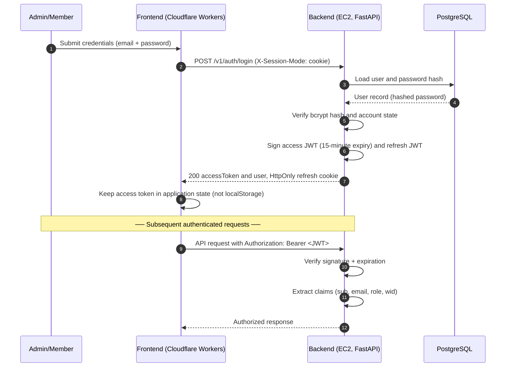

> **Key details**: bcrypt cost factor 12; JWT signed with HS256 using a secret from SSM; 15-minute access tokens. In a browser session (`X-Session-Mode: cookie` from a trusted origin) the refresh token travels only in the HttpOnly cookie; other clients exchange it in the request body. Token validation runs on every protected route.

## 2) AI-Assisted Requirements Refinement

Generation produces editable proposals; it does not create stored stories or ambiguity records.

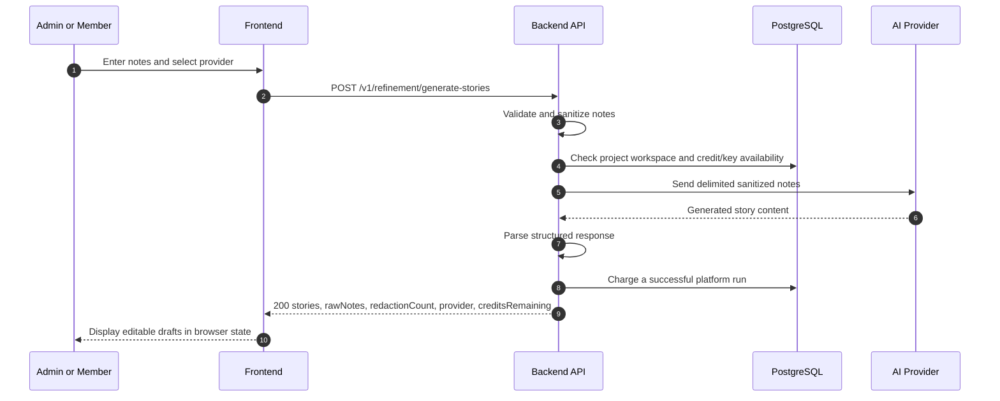

## 3) Explicit Approval and Client Review Visibility

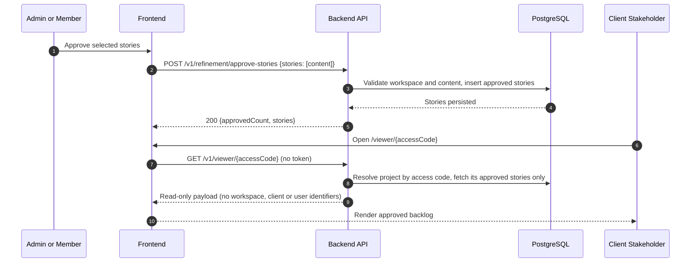

## 4) Markdown Export Workflow

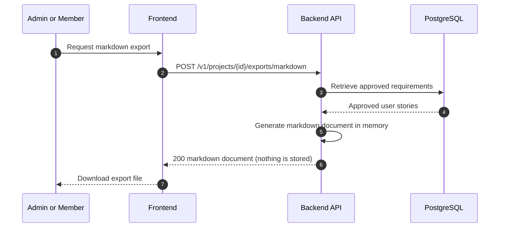

## 5) Error Handling and Observability Path

Validation failures are actionable client errors. Optional exception capture is a separate path.

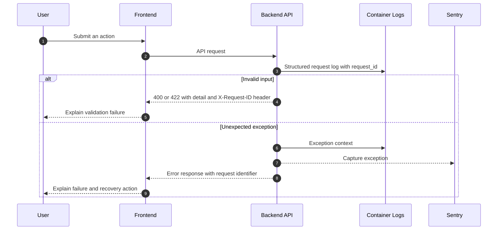

See [Monitoring and Observability](../ops/monitoring-observability.md) for the current limits. The frontend also reports to Sentry through its own SDK (`VITE_SENTRY_DSN`, set at build time); backend Sentry is configured independently.

## 6) User Registration and Email Verification

Registration creates a pending account; verification establishes ownership before login and credit allocation.

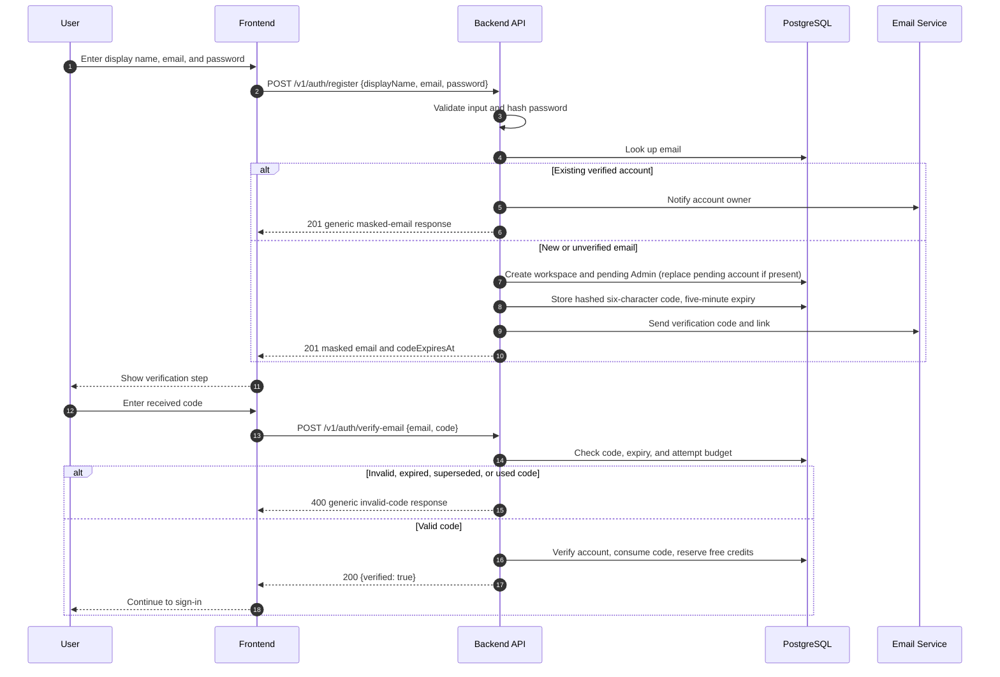

Verification codes use `23456789ABCDEFGHJKLMNPQRSTUVWXYZ` and are case-insensitive. Self-registration codes expire after five minutes; invited Members receive a 24-hour code and set their password during verification. Five wrong guesses lock a code; the registration code plus three resends are allowed in a 15-minute issuance window. These limits differ from password-reset issuance.

## 7) Password Reset

The request response does not disclose whether the email has an account. Reset invalidates refresh sessions; existing access tokens retain their normal short expiry.

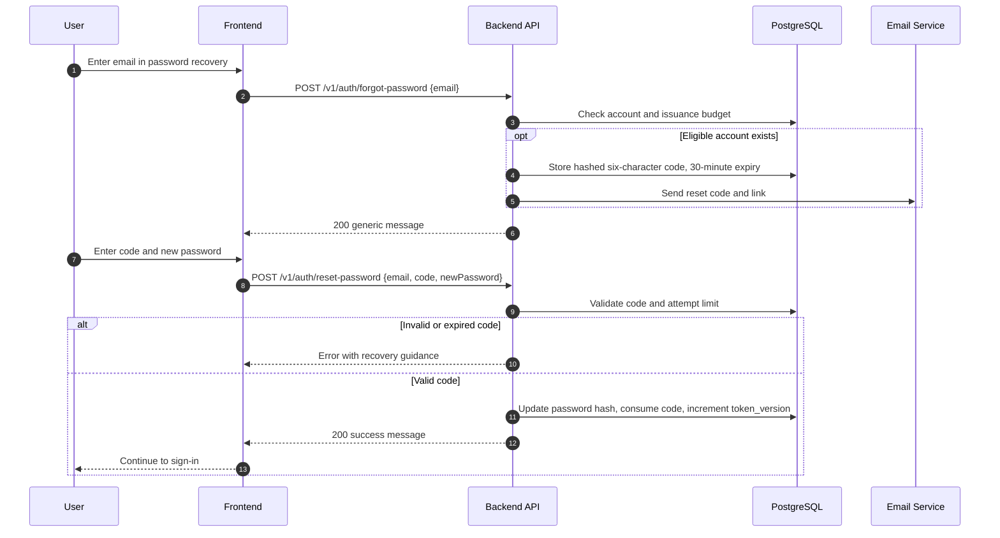

The initial request and resends share a three-code limit per account per 15 minutes. `POST /v1/auth/resend-reset-code` issues a replacement subject to that budget; IP throttling is separate.

## 8) Login with Rate Limiting and Lockout

Cookie-mode requests include a trusted Origin; refresh rotates the credential rather than reusing it.

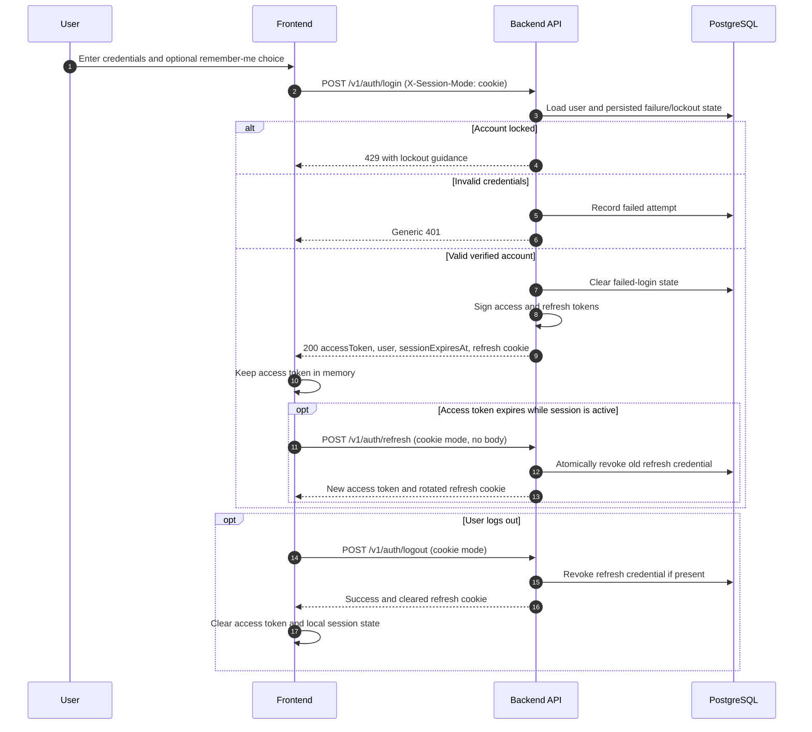

Access tokens last 15 minutes by default; refresh lifetimes slide 24 hours or seven days with remember-me. Five failed attempts in the account window trigger lockout; repeated failures can increase its duration. An unverified account is refused login after its password matches.

## 9) Authorization 3-Layer Defense

Authentication, role permissions, and workspace filtering protect different boundaries. A denied request does not proceed to the next gate.

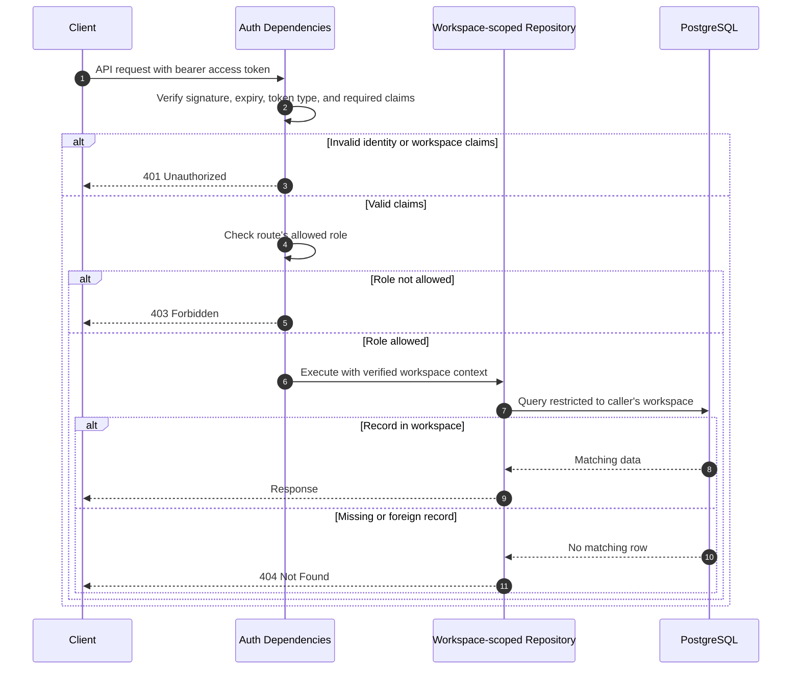

Workspace isolation is enforced by the application; PostgreSQL Row-Level Security is not enabled. Client Review is a separate public flow scoped by one project's access code.

## 10) Client Review by Access Code

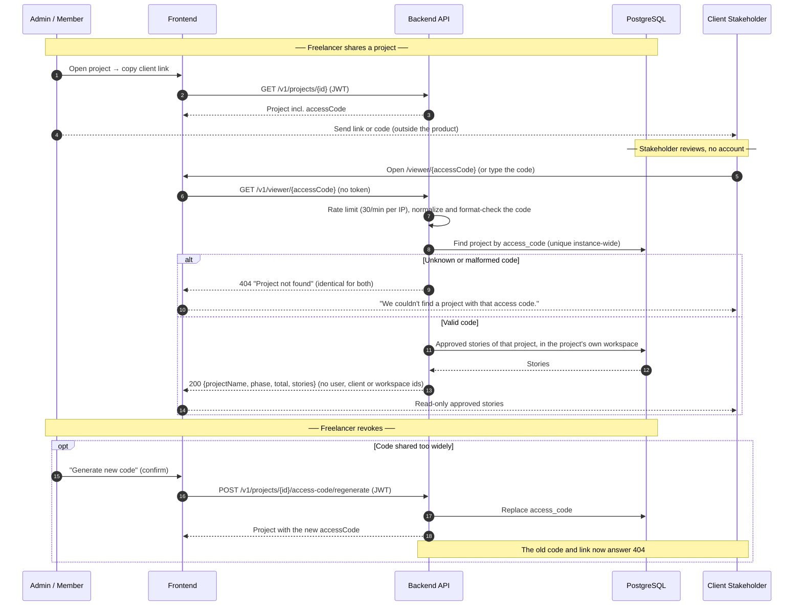

> **Code security**: `PRJ-` plus 8 characters from a 32-symbol alphabet (about 10^12 values), cryptographically random, unique across workspaces, and independent of the freelancer-chosen project code. The route is read-only, rate limited, and answers every miss identically (FR-011-04, FR-011-07, NFR-011-01, NFR-011-02; ADR-020).

---

## 11) AI Credits Consumption and API Key Management

Platform credits and user-owned provider quota are separate. Validation and storage never return the plaintext key.

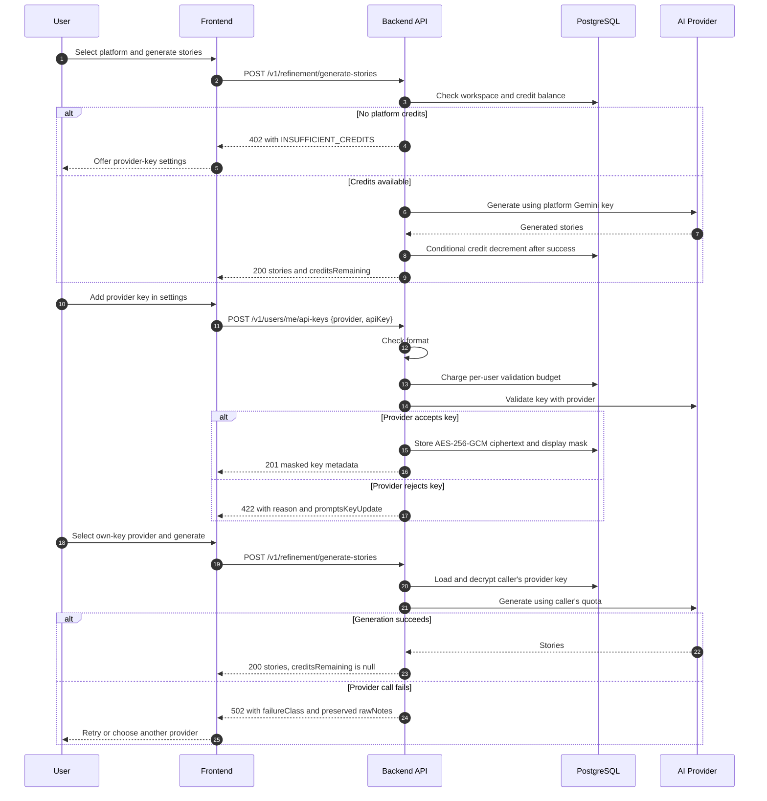

Saving and explicit revalidation share five provider-validation attempts per user per hour. A failed platform generation does not consume a credit. Five free credits are granted on verification subject to the workspace's 25-credit lifetime ceiling; no purchase/payment flow is implemented.

## 12) AI Refinement Security Pipeline

This sequence shows implemented controls. Pattern-based sanitization and structured parsing do not establish that generated content is safe or correct.

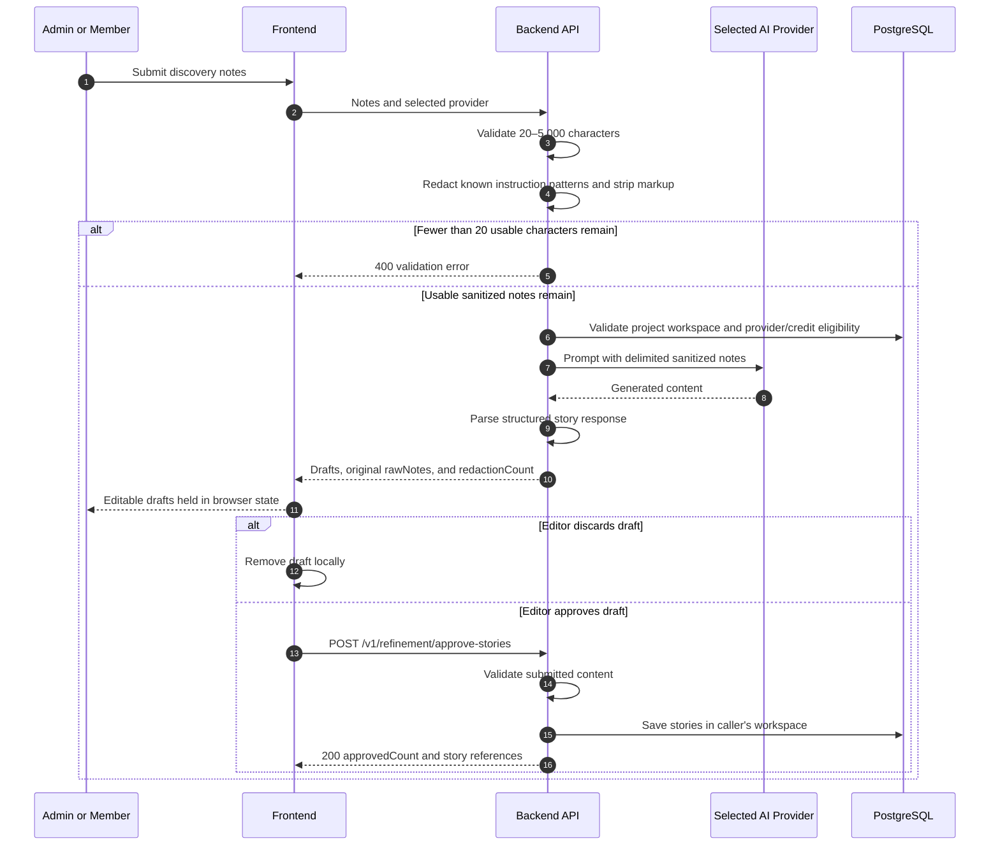

There is no dedicated moderation call, toxicity filter, or system-prompt-leak detector in this flow. Unapproved drafts do not reach the stored backlog, export, or Client Review route. See [AI Refinement Controls](../security/security-architecture.md#ai-refinement-controls).

## 13) CI/CD Pipeline

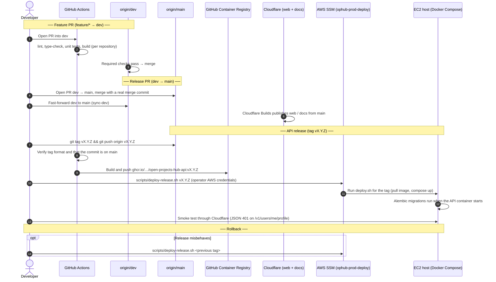

> **Branch model**: Two permanent branches (`dev` + `main`), direct-repository feature branches, and tag-triggered image builds. GitHub OIDC is not available in the AWS account, so the deploy step is run by a person ([ADR-023](../../04-decisions/adr-023-credits-account-us-east-2-manual-deploy.md)). See the [CI/CD Pipeline](../ops/ci-cd-pipeline.md) for branching, deploy and rollback details.

---

## Diagram Coverage by Feature

| Diagram                                      | Feature / Architecture Domain                        |
| -------------------------------------------- | ---------------------------------------------------- |
| 1 — Authentication & Session Validation      | F-007 (login), security-architecture.md              |
| 2 — AI-Assisted Requirements Refinement      | F-002 (AI refinement), F-004 (backlog)               |
| 3 — Explicit Approval & Client Review Visibility | F-002 (approval), F-003 (access control)             |
| 4 — Markdown Export                          | F-004 (export)                                       |
| 5 — Error Handling & Observability           | NFR-X01 through NFR-X06, monitoring-observability.md |
| 6 — User Registration & Email Verification   | F-008 (account creation), F-005 (onboarding trigger) |
| 7 — Password Reset                           | F-009 (password reset)                               |
| 8 — Login with Rate Limiting & Lockout       | F-007 (admin login)                                  |
| 9 — Authorization 3-Layer Defense            | F-003 (access control), security-architecture.md     |
| 10 — Client Review by Access Code            | F-011 (client review access)                         |
| 11 — AI Credits & API Key Management         | F-010 (AI credits), ADR-018 (key encryption)     |
| 12 — AI Refinement Security Pipeline | F-002 (AI refinement), security-architecture.md      |
| 13 — CI/CD Pipeline                          | ci-cd-pipeline.md, deployment-architecture.md        |

## Source References

- [Architecture Solution Design](../core/architecture-solution-design.md)
- [API Contract](../api/api-contract.md)
- [Security Architecture](../security/security-architecture.md)
- [CI/CD Pipeline](../ops/ci-cd-pipeline.md)
- [Feature Requirements](../../01-requirements/README.md)
- [F-007: Admin Login](../../01-requirements/f-007-admin-login.md)
- [F-008: Account Creation](../../01-requirements/f-008-create-account.md)
- [F-009: Reset Password](../../01-requirements/f-009-reset-password.md)
- [F-010: AI Credits and API Key Management](../../01-requirements/f-010-ai-credits-and-api-key-management.md)
- [F-011: Client Review Access](../../01-requirements/f-011-client-review-access.md)

---

**Last Updated**: 2026-10-19
