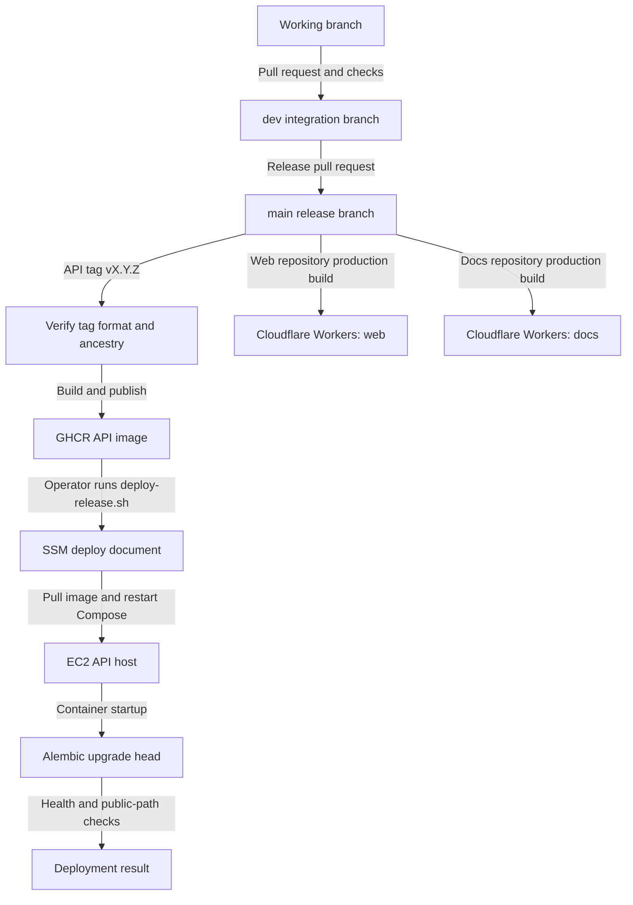

# CI/CD and release architecture

This page describes the workflows committed in the reviewed repositories. GitHub Actions validates changes and publishes API images; API deployment is an operator action. Web and documentation publishing are handled separately by Cloudflare Builds.

## Branch and review model

The intended repository flow uses named working branches, pull requests into integration branch `dev`, and release pull requests from `dev` into `main`. Conventional Commits describe changes. The original rationale is retained in [ADR-016](../../04-decisions/adr-016-git-workflow-strategy.md).

Required approvals, branch rules, tag protection, and repository permissions are hosted settings. Their current values were not queried in this review; earlier tables describing one or two mandatory approvals should be read as policy intentions rather than verified enforcement.

## Validation by repository

| Repository | Committed checks | Important boundary |
| --- | --- | --- |
| API | Ruff lint and formatting, Bandit, non-integration pytest, Alembic upgrade/downgrade against a temporary PostgreSQL database | Mypy uses `continue-on-error`; repository integration tests are excluded and the workflow records that they need repair |
| Web | `npm run verify`: ESLint, unit tests, TypeScript, Vite build | Playwright E2E tests are not run by this CI job |
| Documentation | TypeScript check and Docusaurus build | Broken links and anchors fail the build; no dedicated lint or test script |
| Infrastructure | Terraform formatting and validation | No automatic apply or destroy |

A migration upgrade/downgrade check proves that migrations can run in its test environment; it is not a replacement for repository integration tests or a production recovery exercise.

## Release flow

*The three `main` release branches belong to separate repositories. Publishing an API image does not deploy it; Cloudflare builds do not deploy the API.*

## API image publication

The API `deploy.yml` runs for a `vX.Y.Z` tag, or a manual workflow run from a tag ref. It verifies the semantic tag format and that the tagged commit is an ancestor of `origin/main`, then builds a Linux AMD64 image and publishes it to GHCR.

The workflow cannot assume an AWS role in the current account. It does not deploy the image or rerun the full CI suite. The branch/review process must establish release readiness before tagging.

## API deployment

The operator runs `scripts/deploy-release.sh vX.Y.Z` from the API repository with credentials for the intended AWS account and region. This invokes the SSM deployment document, which reads SSM parameters, writes host runtime configuration, pulls the tagged image, and starts the Compose stack.

- The database retains its data on the host volume.
- Alembic migrations run when the API container starts.
- Container readiness and a public-path smoke check establish the deployment script's result.
- There is one API container, so restarting it can interrupt service.
- Configuration changes in SSM take effect on the next deployment.

This is an operational description, not authorization to trigger a release. Exact commands, permissions, and first-release prerequisites belong in the API and infrastructure runbooks linked from the [run guide](../../00-context/run-the-system.md).

## Web and documentation publishing

Cloudflare Builds publishes the web and documentation repositories independently from their production branches. Public frontend configuration is compiled into each build; secrets must not be embedded in browser assets.

The docs Worker serves `build/` at its own hostname. Its GitHub workflow only checks type correctness and the site build. It does not publish the site.

## Rollback and recovery

| Area | Procedure | Limitation |
| --- | --- | --- |
| API application | Deploy a known-good existing image tag with the manual deployment script | Only safe when the image is compatible with the current schema |
| Database schema | Assess compatibility and use a forward fix where needed | Migrations do not automatically reverse when an old image is deployed |
| Web or docs | Restore a known-good Cloudflare deployment, or release a corrective commit | Browser clients may briefly use cached assets |
| Infrastructure | Review a corrective Terraform plan before applying it | Reverting source alone does not undo external infrastructure changes |
| Lost database volume | Recreate the host and deploy the application | There are no automated backups; lost data cannot be restored without a separately retained manual dump |

There is no zero-downtime rollout, automated application rollback, database restore guarantee, or separate staging deployment in the current system.

## Secrets and supply chain

Platform runtime secrets are SSM SecureString parameters. The API image publication uses GitHub's scoped package-publishing token; AWS deploy credentials are not stored in the release workflow. Source changes and release-tag permissions still matter because the host runs scripts from the tagged API revision.

Dependency updates, image scanning, signed artifacts, and hosted protection rules must be distinguished from controls that are actually configured. Do not infer their enforcement from the presence of a design requirement.

## Source references

- [API CI](https://github.com/alonsovndev/open-projects-hub-api/blob/63f1512f9cf879d4d71570ce59ff9aa691a426b1/.github/workflows/ci.yml)
- [API image publication](https://github.com/alonsovndev/open-projects-hub-api/blob/63f1512f9cf879d4d71570ce59ff9aa691a426b1/.github/workflows/deploy.yml)
- [Web CI](https://github.com/alonsovndev/open-projects-hub-web/blob/059ca287591e7414d656aa2492a6e5bc2b44fd76/.github/workflows/ci.yml)
- [Deployment architecture](./deployment-architecture.md)
- [ADR-023: account, region, and manual deployment](../../04-decisions/adr-023-credits-account-us-east-2-manual-deploy.md)
