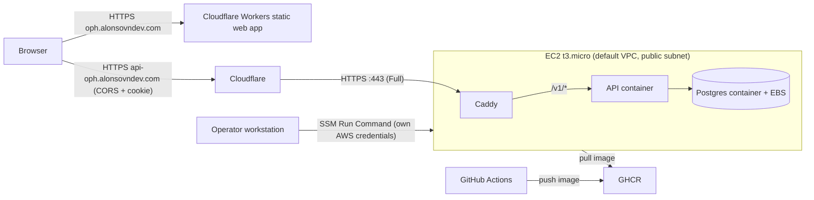

# Deployment & Infrastructure Architecture

| Attribute        | Value                       |
| ---------------- | --------------------------- |
| **Project**      | Open Projects Hub |
| **Version**      | 3.0                         |
| **Status**       | Accepted                    |

## Table of Contents

- [Source References](#source-references)
- [1. Scope and NFR Alignment](#1-scope-and-nfr-alignment)
- [2. Cloud Platform Selection and Rationale](#2-cloud-platform-selection-and-rationale)
- [3. Deployment Architecture](#3-deployment-architecture)
- [4. Backup and Disaster Recovery](#4-backup-and-disaster-recovery)
- [5. Environment Strategy](#5-environment-strategy)
- [6. Cost Optimization Strategy](#6-cost-optimization-strategy)
- [7. Infrastructure as Code (IaC) Approach](#7-infrastructure-as-code-iac-approach)
- [8. Security Architecture Considerations](#8-security-architecture-considerations)
- [9. Deployment Impact Summary (GitHub Actions)](#9-deployment-impact-summary-github-actions)
- [10. Related ADRs](#10-related-adrs)
- [11. Implementation Status and Next Steps](#11-implementation-status-and-next-steps)

---

## 1. Scope and NFR Alignment

This document defines the production deployment architecture for the master's-review release. It is sized for a handful of users and near-zero traffic, so cost takes priority over availability and recovery. The decision and its trade-offs are recorded in [ADR-021](../../04-decisions/adr-021-low-cost-single-host-deployment.md), which supersedes the compute, database and network parts of ADR-006.

## 2. Cloud Platform Selection and Rationale

### 2.1 Decision: AWS-First Platform

**Selected:** **Amazon Web Services (AWS)** as the single cloud provider.

**Rationale:**

- One provider for billing, IAM and monitoring.
- The AWS account (the one holding the credits, `us-east-2`, see [ADR-023](../../04-decisions/adr-023-credits-account-us-east-2-manual-deploy.md)) is on the **Free Plan**: on 2026-10-19 the console showed $119.99 in credits remaining and 174 days left (ends 2027-04-09; consistent with $100 of sign-up credit plus $20 earned from Explore AWS activities). The plan ends at that date or when the credits run out, whichever comes first. The design costs about $12-13/month: about $52 for the four months until the review and about $77 for the whole window.
- Infrastructure as Code (Terraform) makes the deployment repeatable and reviewable.

**Trade-offs Accepted:**

- No high availability, no managed database and no backups (see section 4).
- The Free Plan has a fixed lifetime and a $100 credit cap; afterwards, or if the credits run out first, the account must be upgraded or the system rehosted.
- Cloudflare's free plan sits in front of the API host. Its connection to the origin is encrypted but the origin certificate is not validated (see section 8).
- The web app and the API are different origins (`oph.alonsovndev.com` and `api-oph.alonsovndev.com`), so the browser calls the API cross-origin and the API must allow credentialed CORS.

### 2.2 Selected Platform Architecture

**AWS Service Mapping:**

- **Frontend Hosting:** not on AWS. The React build is a Cloudflare Workers static-assets deployment at `https://oph.alonsovndev.com`, built and deployed by Cloudflare from the web repository on GitHub
- **Backend Compute:** one Amazon EC2 `t3.micro` running Docker Compose (Caddy, the FastAPI API, PostgreSQL)
- **Database:** PostgreSQL 15 container on the same host, data on the instance's EBS volume
- **Entry point:** a proxied Cloudflare DNS record `api-oph.alonsovndev.com` to the host's Elastic IP; Caddy proxies `/v1/*` to the API and answers 404 for anything else
- **Container Registry:** public GitHub Container Registry (no ECR)
- **Secrets and configuration:** AWS Systems Manager Parameter Store (Standard tier)
- **Authentication:** Custom JWT-based auth module in the FastAPI backend (see ADR-005)
- **Infrastructure as Code:** Terraform in the `open-projects-hub-infra` repository
- **Observability:** Sentry (optional, off until a DSN is set) and container logs on the host
- **CI/CD:** GitHub Actions builds and publishes the API image; the deploy is started by hand with `scripts/deploy-release.sh` using the operator's AWS credentials (GitHub OIDC is blocked in the account, see ADR-023)

## 3. Deployment Architecture

See also: [ADR-021: Low-Cost Single-Host Deployment](../../04-decisions/adr-021-low-cost-single-host-deployment.md).

### 3.1 Compute Resources

- **Backend API:** one EC2 `t3.micro` (1 GB RAM, 2 GB swap) in the default VPC's public subnet, with an Elastic IP.
  - Docker Compose runs three containers: Caddy (port 443), the API (Gunicorn, one worker) and PostgreSQL.
  - Caddy answers only on port 443, with its own local-CA certificate (`tls internal`), and takes the viewer address from `CF-Connecting-IP`.
  - Health checks: `/health/live` (container health) and `/health/ready` (database check, used by the deploy script). These routes live at the root, not under `/v1`, and are reached from the host, not through Cloudflare.
  - Database migrations run when the API container starts (`alembic upgrade head`); one instance means no migration race.
  - CPU credits run in `standard` mode so the instance throttles instead of billing surplus CPU.
- **Frontend:** a static React build on Cloudflare Workers, outside AWS.
  - Cloudflare builds it from the web repository (`npm run build`, then `wrangler deploy`); `wrangler.jsonc` serves `dist` with SPA routing.
  - The production build sets `VITE_API_BASE_URL=https://api-oph.alonsovndev.com`; the CSP `connect-src` is derived from it.
  - Caddy on the host serves no web files: it proxies `/v1/*` and answers 404 elsewhere. The API itself sets HSTS, `X-Content-Type-Options`, `X-Frame-Options` and the CSP.
- **Serverless functions:** not used.

### 3.2 Database and Storage

- **Primary Database:** PostgreSQL 15 in a container.
  - `max_connections` is 30 and `shared_buffers` 64 MB; the API uses at most 20 connections from its single worker.
  - Data lives in a Docker volume on the instance's encrypted 20 GB gp3 EBS volume.
  - Not reachable from outside the host: no published port.
- **Authentication:** custom JWT module in the backend; credentials stored in the `users` table with bcrypt hashing.
- **File Storage:** none today. The application does not store files in S3.

### 3.3 Networking

**Public Ingress (HTTPS to the viewer):**

- A proxied Cloudflare DNS record (an A record to the host's Elastic IP) for `api-oph.alonsovndev.com`. The name has one label under the zone so Cloudflare's free Universal certificate covers it. SSL/TLS mode is Full and Always Use HTTPS is on.
- The web hostname `oph.alonsovndev.com` is a Workers custom domain managed in Cloudflare, separate from this record.
- The API sends the CORS headers (`CORS_ORIGINS` and `CORS_ALLOW_CREDENTIALS=true` in SSM, `X-Session-Mode` allowed) and the refresh cookie itself. `SameSite=Lax` is enough because both hostnames share the registrable domain `alonsovndev.com`.
- Cloudflare forwards cookies and headers unchanged and does not cache `/v1/*` (JSON responses are not cached by default, and auth responses carry `Cache-Control: no-store`). The proxy's timeout for a response from the origin is 100 seconds on the free plan.

**Host exposure:**

- The security group admits TCP 443 only from a managed prefix list of Cloudflare's IPv4 ranges (read from Cloudflare by Terraform). There is no SSH; operators use SSM Session Manager.
- Outbound traffic is open (image pulls, SSM, SMTP, AI providers).
- No NAT Gateway or load balancer is used, which keeps the cost near the instance price.

**DNS:** the zone `alonsovndev.com` lives in Cloudflare. Terraform creates one proxied A record for the API hostname; the one-time Cloudflare setup (API token, SSL mode) is in the `open-projects-hub-infra` README, section "Cloudflare setup".

### 3.4 Scaling Strategy

- Single instance, no autoscaling. The expected load is a handful of users.
- Vertical scaling is the only lever: a larger instance type, then a higher Gunicorn worker count and connection limits.
- Static assets are served by Cloudflare Workers, so the host handles only API traffic.

### 3.5 High Availability and Failover

- None for the API and database: one host, one availability zone. A host failure means downtime until it is replaced.
- Cloudflare (Workers and proxy) and S3 (Terraform state) are managed services with their own durability and availability.
- A deploy restarts the API container; expect a short interruption.

## 4. Backup and Disaster Recovery

**There are no database backups, by decision** (ADR-021). The deployment is a low-stakes review environment.

| Data/Service                | Backup Approach                                    | Recovery |
| --------------------------- | -------------------------------------------------- | -------- |
| PostgreSQL (application data) | None                                             | Data is lost if the instance volume or account is lost |
| Web assets (Cloudflare Workers) | Rebuilt from the Git branch by Cloudflare Builds | Redeploy from the Cloudflare dashboard |
| API image                   | Rebuilt from the tagged Git commit by CI/CD        | Re-run the API deploy workflow |
| Infrastructure              | Terraform code in Git, state in a private versioned S3 bucket | `terraform apply` |
| Configuration and secrets   | SSM Parameter Store                                | Re-create manually if the account is lost |

**Protection against accidents:**

- The instance has termination protection and Terraform `prevent_destroy`; only the guarded teardown workflow lifts them.
- `API_KEY_ENCRYPTION_KEY` must never be rotated; stored user API keys become undecryptable.
- A manual `pg_dump` can be taken over SSM Session Manager if a copy is ever needed.

**Recovery runbook (host lost):** apply Terraform to recreate the host, run the API deploy workflow for the current tag, then seed the admin user again with the `seed-admin` Compose profile (it needs `ADMIN_EMAIL` and `ADMIN_PASSWORD`; see the infra repository README). User data is gone.

## 5. Environment Strategy

| Environment    | Purpose                | Configuration                                       | Cost Target |
| -------------- | ---------------------- | --------------------------------------------------- | ----------- |
| **Local**      | Developer workstations | `APP_ENV=local`, API run directly, local PostgreSQL | $0          |
| **Test**       | Automated tests        | `APP_ENV=test`                                      | $0          |
| **Container**  | Docker Compose run, same image that is deployed | `APP_ENV=container`        | $0          |
| **Production** | Master's-review release | EC2 + Cloudflare, `APP_ENV=prod`                   | about $12-13/month from the $100 Free Plan credits |

**Environment Isolation:**

- Production is the only environment on AWS; the other environments never touch it.
- Environment-specific secrets (JWT key, database password, encryption key) are generated by Terraform and stored in SSM.
- The `container` environment is the pre-release smoke test, because it builds and runs the same Docker image.

**Promotion Path:** `dev` branch -> Pull Request -> `main` branch -> `vX.Y.Z` tag -> deployment.

## 6. Cost Optimization Strategy

**Expected monthly cost (us-east-1 list prices; `us-east-2` not checked, TBD; always on):**

| Item | Approx. cost |
| --- | --- |
| EC2 `t3.micro` | $7.60 |
| Public IPv4 address (Elastic IP) | $3.65 |
| 20 GB gp3 volume | $1.60 |
| Cloudflare (free plan), S3, SSM, IAM | $0 (the domain is already owned; its yearly renewal is paid at the registrar) |
| **Total** | **about $12.85, paid from the $100 Free Plan credits** |

**Cost Management Actions:**

- A $1 budget alerts on any real (post-credit) charge; a second budget alerts when gross usage passes $16 in a month so credit burn is visible.
- No NAT Gateway, load balancer, RDS, ECR, Route 53 zone or snapshots.
- Logs rotate (10 MB x 3 files per container) so they cannot fill the disk.
- The instance can be stopped between review sessions to save about $7.60/month; the data survives a stop.

**After the Free Plan ends:** the account must be upgraded (about $13/month for this design) or the system moved elsewhere. The plan can also end earlier if the $100 runs out.

## 7. Infrastructure as Code (IaC) Approach

**Selected Tool:** Terraform (see ADR-013), in the separate `open-projects-hub-infra` repository.

**Managed Resources:**

- **Compute:** EC2 instance, Elastic IP, security group, instance role and profile, first-boot script (Docker, Compose plugin, swap).
- **Edge and storage:** the Cloudflare DNS record (Terraform Cloudflare provider, token from the environment) and the managed prefix list of Cloudflare ranges. The web app is deployed by Cloudflare and is not in Terraform.
- **Secrets:** generated secrets and placeholders in SSM Parameter Store.
- **Delivery access:** the restricted SSM deploy document, run by the operator (no GitHub OIDC provider or deploy role, see ADR-023).
- **Cost control:** AWS Budgets.

**Terraform Configuration:**

- **State Management:** private, versioned, encrypted S3 bucket with native state locking (no DynamoDB table).
- **Layout:** `bootstrap/` (state bucket, applied once), `envs/prod/`, and two modules: `compute`, `deploy`.
- **Secrets Handling:** secrets are generated in Terraform and stored in SSM; the state bucket is private because state contains them.

**Governance:**

- A pull-request workflow runs `terraform fmt -check` and `validate`.
- `terraform apply` is run locally by the owner after reviewing the plan. CI never applies.

## 8. Security Architecture Considerations

**Transport Security:**

- Viewers always use HTTPS (Cloudflare edge certificate, HTTP redirected, HSTS header).
- The Cloudflare-to-EC2 leg is HTTPS, but Caddy's certificate comes from its own local CA, which Cloudflare accepts in SSL mode Full without validating it. **Accepted risk:** a party able to intercept traffic between Cloudflare and AWS could impersonate the origin. The upgrade is a Cloudflare Origin CA certificate on Caddy with SSL mode Full (strict).
- The refresh-token cookie is `HttpOnly`, `SameSite=Lax` and `Secure`, scoped to `/v1/auth`. The API accepts cookie sessions only from the exact web origin in `CORS_ORIGINS`/`FRONTEND_BASE_URL`; preview deployments on other origins are rejected.

**Authentication & Authorization:**

- Custom JWT-based authentication in the FastAPI backend (see ADR-005) with role-based access control.

**Network Security:**

- Only Cloudflare's ranges can reach port 443 (security group prefix list). Those ranges are shared by every Cloudflare customer, so another Cloudflare account could proxy to this host if it learned the Elastic IP; there is no shared secret header. Accepted for this deployment; Authenticated Origin Pulls or a Cloudflare request-header rule would close it. Caddy replaces `X-Forwarded-For` with the viewer address in `CF-Connecting-IP`, so a client-supplied `X-Forwarded-For` is ignored.
- No SSH; shell access is through SSM Session Manager, and instance metadata requires IMDSv2.
- The database is not published outside the Docker network.

**Secrets Management:**

- Secrets live in SSM Parameter Store (SecureString) and are written to a root-only `.env` on the host by the deploy script (see ADR-011, ADR-021).
- Placeholder values (`N/A`) are not written to `.env`, so the variable stays unset.
- GitHub Actions never reach AWS; no AWS keys of any kind are stored in GitHub.

**Deploy access:**

- Deploys run the SSM document `ophub-prod-deploy` with the operator's AWS credentials. The document accepts only a `vX.Y.Z` tag and fetches the deploy script from the tagged commit of the public repository, so tag protection on `v*` still matters (it decides what the host runs) and is set up by hand (see the infra repository README).

**Data Protection:**

- The EBS volume is encrypted; the Terraform state bucket is private and encrypted.

**Input Validation & API Security:**

- Pydantic validation, rate limiting (per viewer address, taken from `CF-Connecting-IP`), CORS allowlist, and parameterized queries via SQLAlchemy.

See [Security Architecture](../security/security-architecture.md) for detailed security controls.

## 9. Deployment Impact Summary (GitHub Actions)

**CI/CD Integration:**

- Each application repository has a `ci.yml` (lint, tests, build); the API repository also has a tag-driven `deploy.yml` that builds the image, and the web repository deploys through Cloudflare.
  1. **Backend:** the workflow builds the Docker image and pushes it to GHCR; the operator then runs `scripts/deploy-release.sh <tag>`, which runs the `ophub-prod-deploy` SSM document so the host pulls the image and restarts the stack.
  2. **Frontend:** built and deployed by Cloudflare Builds from the web repository (GitHub integration), with the API URL set in `.env.production`. No AWS access is involved.
  3. **Database:** Alembic migrations run when the API container starts.
  4. **Infrastructure:** Terraform is applied locally; CI only validates it.

**Deployment Workflow:**

- Deployments are triggered by pushing a `vX.Y.Z` tag, or manually from a tag ref.
- The deploy script fails the workflow if the stack does not start healthy: Docker Compose waits for the API health check (about two minutes at most), then the script waits up to 90 more seconds for `/health/ready`.

**Rollback Strategy:**

- Application: re-run the deploy workflow on the previous tag. Migrations are forward-only, so a rollback across a schema change needs a forward fix.
- Frontend: redeploy the previous build from the Cloudflare dashboard, or revert the commit.
- Edge: delete the `api-oph` DNS record in Cloudflare to take the API offline without touching AWS.
- Infrastructure: revert the Terraform change and apply.

## 10. Related ADRs

- [ADR-004: Database](../../04-decisions/adr-004-database.md) (database now runs as a container; see ADR-021)
- [ADR-005: Authentication Strategy (Custom JWT Auth)](../../04-decisions/adr-005-authentication.md)
- [ADR-006: Deployment Platform (AWS)](../../04-decisions/adr-006-deployment-platform.md) (superseded in part)
- [ADR-011: Secrets Management Strategy](../../04-decisions/adr-011-secrets-management.md)
- [ADR-012: Containerization Strategy](../../04-decisions/adr-012-containerization.md)
- [ADR-013: Infrastructure as Code Strategy](../../04-decisions/adr-013-infrastructure-as-code.md)
- [ADR-014: Environment Strategy](../../04-decisions/adr-014-environment-strategy.md)
- [ADR-017: Database Migration Strategy](../../04-decisions/adr-017-database-migration-strategy.md)
- [ADR-021: Low-Cost Single-Host Deployment](../../04-decisions/adr-021-low-cost-single-host-deployment.md)
- [ADR-022: Cloudflare Edge Instead of CloudFront](../../04-decisions/adr-022-cloudflare-edge-instead-of-cloudfront.md)
- [ADR-023: Credits Account in us-east-2 and Manual Deploys](../../04-decisions/adr-023-credits-account-us-east-2-manual-deploy.md)

## 11. Implementation Status and Next Steps

Status as of 2026-10-19. The stack is **live** at `https://api-oph.alonsovndev.com` and the web app at `https://oph.alonsovndev.com` calls it; the end-to-end sign-up has not been verified yet.

**Done**

- The first stack was applied in an older AWS account without credits and destroyed on 2026-10-16 (32 resources). The credits account sits under an organization whose SCPs allow EC2 only in `us-east-2` and block the GitHub OIDC provider, so the stack moved there without OIDC ([ADR-023](../../04-decisions/adr-023-credits-account-us-east-2-manual-deploy.md)).
- In the credits account: `bootstrap/` (state bucket, 6 resources) and `envs/prod` (30 resources: EC2 host, Elastic IP, security group with Cloudflare ranges, SSM parameters and deploy document, budgets, Cloudflare DNS record) are applied. The host's first boot finished (`cloud-init: done`, Docker 25, Compose v2.29).
- API `v0.1.0`: the image is public in GHCR and was deployed with `scripts/deploy-release.sh v0.1.0` (SSM command `Success`).
- Verified from outside: an unauthenticated `GET /v1/users/me/profile` returns a JSON 401 through Cloudflare; the CORS preflight from `https://oph.alonsovndev.com` returns 200 with `allow-credentials: true`; a foreign origin gets 400; the Elastic IP refuses direct connections; non-`/v1` paths return 404; the production web bundle contains the API URL.
- SMTP parameters (Resend, sending domain `send.alonsovndev.com`, verified) are set in SSM and were read by the deploy.
- The Cloudflare edge decision is in [ADR-022](../../04-decisions/adr-022-cloudflare-edge-instead-of-cloudfront.md).

**Not done or not verified**

- Self-registration end to end (verification email, code, login, refresh cookie on the API host, reload, logout): to be tested in the browser.
- The admin user is not seeded.
- The `deploy.yml` change (build only) has not run, because it needs a new tag.
- Other pages still describe App Runner, RDS and CloudFront (see below).

**Next steps, in order**

1. Test sign-up and login in the browser at `https://oph.alonsovndev.com`.
2. Optionally seed the admin user (one-off over SSM, with the password given outside any chat).
3. Watch credit use against the two budgets; at about $12.85/month the 174 days cost roughly $73, so the date, not the balance, is the limit.

**Follow-ups and open decisions**

- GitHub CI had been removed from the API and web repositories on 2026-10-08 (commit "chore: remove Github CI/CD", reason not recorded). A smaller CI was added back and the owner decided to keep it (2026-10-10).
- Email: Resend with the verified sending domain `send.alonsovndev.com` is configured (sender `no-reply@send.alonsovndev.com`); delivery from production is still to be confirmed by a real sign-up.
- Sweep the remaining pages that mention App Runner, RDS or CloudFront: `core/technology-stack.md`, `core/architecture-solution-design.md`, the security and database docs, `diagrams/sequence-diagrams.md`, `monitoring-observability.md` and `api/*`.
- Remove the now-unreferenced `images/deployment-arch-aws.png` and `images/git-ci-cd-pipeline.png` once the Mermaid diagrams are accepted.

## Source References

- [Requirements Home](../../01-requirements/README.md)
- [ADR-021: Low-Cost Single-Host Deployment](../../04-decisions/adr-021-low-cost-single-host-deployment.md)
- [ADR-006: Deployment Platform (AWS)](../../04-decisions/adr-006-deployment-platform.md)
- [ADR-013: Infrastructure as Code Strategy](../../04-decisions/adr-013-infrastructure-as-code.md)

---

**Last Updated**: 2026-10-10
