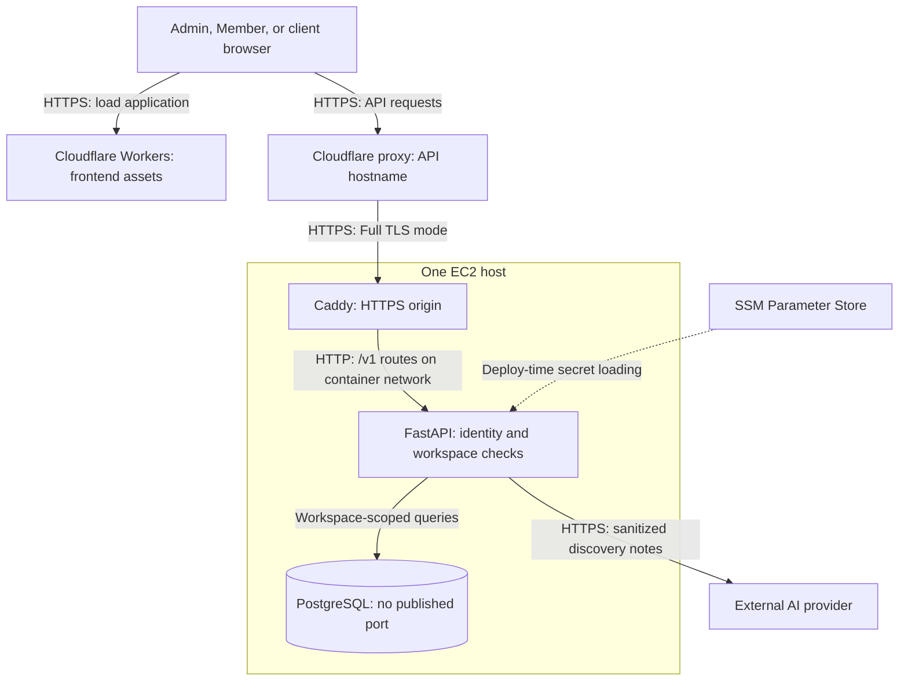
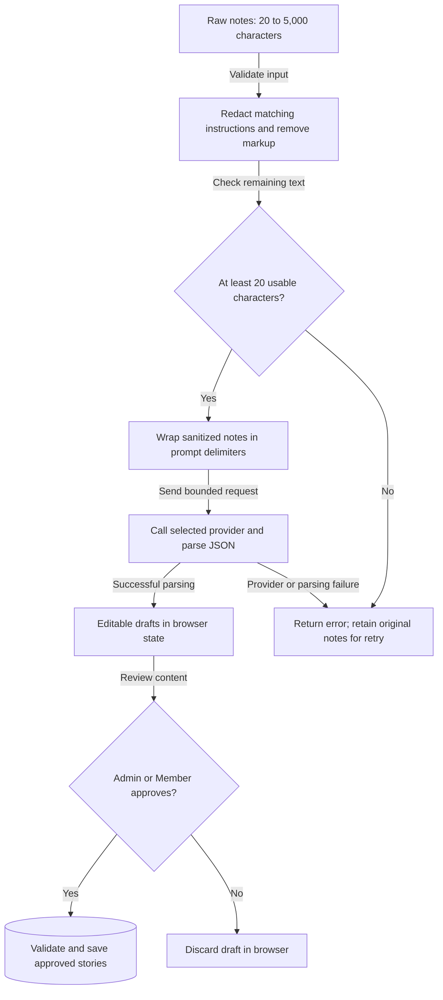

# Security Architecture

This page describes controls present in the review release and the limitations that remain. It is an implementation summary, not a certification of OWASP compliance or a penetration-test report.

## System boundaries

The React frontend runs on Cloudflare Workers. API traffic passes through the Cloudflare proxy to Caddy on one EC2 host. FastAPI and PostgreSQL run as containers on that host.

*Figure 1. Current request and data boundaries. Cloudflare's Full TLS mode encrypts the origin connection without validating the origin certificate.*

The security group admits port 443 only from Cloudflare's configured IPv4 ranges; operators use SSM rather than SSH. PostgreSQL publishes no host port. The API and database share a Compose network: this internal connection is not an RDS private-subnet or managed-database control. See [Deployment Architecture](../ops/deployment-architecture.md) for the deployment and recovery limits.

## Authentication strategy

The API uses bcrypt password hashing (cost 12) and HS256 JWTs. Access tokens expire after 15 minutes by default. Refresh tokens rotate on use; revoked-token hashes and account lockouts are persisted in PostgreSQL.

| Control | Implemented behavior |
| --- | --- |
| Self-registration | Creates an unverified Admin and a new workspace; no session is issued until verification. |
| Account privacy | An existing verified email receives the same registration response shape as a new email; password-reset requests also use a generic response. |
| Verification | Six-character alphanumeric code, stored hashed; five-minute self-registration expiry and 24-hour member-invitation expiry. |
| Password reset | Hashed, single-use code with a 30-minute expiry; password reset increments the user's token version to invalidate existing refresh tokens. |
| Login failures | Five failed attempts in the configured window trigger account lockout; repeated failures can increase its duration. |
| Sessions | Refresh lifetime slides from the last refresh: 24 hours normally, seven days with `rememberMe`. |
| Password policy | The API requires at least eight characters, a letter, and a digit; the web password-setting form asks for a stricter combination. |

### Browser sessions

The web app opts into cookie mode with `X-Session-Mode: cookie` and a trusted `Origin`. Login and refresh return the access token in JSON and the refresh token only in the `oph_refresh_token` cookie. The web app holds the access token in application memory.

The production refresh cookie is `HttpOnly; Secure; SameSite=Lax; Path=/v1/auth`. Cookie-mode refresh rejects body credentials and untrusted origins. Non-browser clients use the body-token contract instead; see the [API Contract](../api/api-contract.md).

Logout revokes the refresh credential and clears the browser cookie. A previously issued access token can remain usable until its short expiry; refresh revocation does not retrospectively remove that token.

## Authorization model

The API resolves the caller's user, role, and workspace from verified token claims. The workspace is never chosen by an untrusted request field.

| Actor | Access |
| --- | --- |
| Admin | Workspace client/project/story operations, refinement, personal API keys, and team/workspace administration. |
| Member | Workspace client/project/story operations, refinement, and personal API keys. |
| Anonymous client | One project's approved stories and phase, using its project access code. |

Protected routes use authentication and role dependencies; tenant-scoped repository operations receive the caller's workspace. Requests for another workspace's records return `404`. These are application controls: PostgreSQL Row-Level Security is not enabled.

### Public Client Review route

`GET /v1/viewer/{accessCode}` exposes approved stories for one project without requiring an account. Its credential is `PRJ-` plus eight characters from a 32-symbol alphabet, generated securely and unique across the instance.

Unknown and malformed codes return the same `404`. An Admin or Member can regenerate a code, revoking the previous link. The route has a 30-requests-per-minute IP limit; the in-memory limiter is not shared across workers.

Anyone holding the code can view the project. Codes do not expire automatically, identify individual readers, or support revocation for one stakeholder. Sharing a code therefore shares access to the approved backlog.

## Data protection and secrets

- Passwords and one-time codes are stored as bcrypt hashes; revoked refresh tokens are represented by hashes.
- User-owned AI keys are encrypted with AES-256-GCM. The owning user ID is associated data; API responses expose a mask, never the plaintext key.
- Runtime secrets are stored in SSM Parameter Store and loaded during deployment. They include database credentials, the JWT secret, and the API-key encryption key.
- Database data resides on the host's encrypted EBS volume. There are no automated database backups in this review deployment.
- Markdown exports are generated in memory; there is no application file-storage bucket or stored export history.
- Browser/API traffic uses HTTPS. The origin-certificate validation limitation is shown in Figure 1.

Changing the master API-key encryption key without a data-migration procedure makes existing stored keys unreadable. A `key_version` field exists, but an operational rotation procedure is not established; see [ADR-018](../../04-decisions/adr-018-user-api-key-encryption.md).

## AI refinement controls

Discovery notes are sent to the selected external provider. The platform-credit path uses Gemini; users can select Gemini, OpenAI, or DeepSeek with their own saved key. The selected provider is a validated API field, not an instruction embedded in the notes.

*Figure 2. Implemented refinement controls. Drafts remain outside the database until explicit approval.*

Sanitization neutralizes known instruction-override phrases and strips markup and prompt-boundary markers. It does not reject every matching input: a sufficiently long sanitized note still reaches the provider, and the response reports `redactionCount`.

The prompt instructs the model to treat the delimited notes as data. Provider adapters request and parse structured output. Approval validates the submitted story content and project workspace before persistence. These controls reduce exposure; they do not prove resistance to every prompt-injection technique.

Dedicated OpenAI Moderation calls, configured cross-provider harm thresholds, toxicity checks, and system-prompt-leak detection are **not implemented controls** in this release. Human approval remains necessary before drafts become shared backlog content.

## API and operational controls

The API applies typed request validation, parameterized ORM queries, configured CORS, security headers, and request identifiers. Authentication, code issuance, API-key validation, and public review have additional throttling controls. The global IP limiter defaults to 100 requests per minute; it is process-local, while account and key-validation counters are persisted.

Application logs are structured JSON in the container. Backend Sentry is active in production and scrubs request URLs and headers before sending. There are no deployed alarms, distributed rate-limit service, or continuously staffed incident-response process documented for this release.

The repositories contain authentication, route-policy, workspace-isolation, and sanitizer tests. Their presence establishes available verification coverage, not a current passing result or independent security assessment. Refer to the repository CI results and a recorded test run when evaluating release readiness.

## Known limitations

| Limitation | Review implication |
| --- | --- |
| One API/database host; no failover or database backups | Host or volume loss can cause downtime and permanent data loss. |
| Cloudflare Full TLS mode | The origin connection is encrypted, but the origin certificate is not validated. |
| Application workspace isolation; no RLS | Correct route and repository scoping remains essential. |
| Process-local IP throttling | Limits reset on restart and do not coordinate across workers. |
| Short-lived bearer access tokens | Logout or password reset prevents future refreshes; an issued access token can survive until expiry. |
| Shared project access codes | A leaked code reveals the approved backlog until regenerated. |
| External AI processing | Submitted notes leave the application boundary; provider availability and policies affect the workflow. |
| No independent security/compliance assessment recorded | OWASP alignment is a design objective, not a certification. |

MFA, social login, backup automation, stronger origin verification, and additional AI-output safeguards remain future work rather than release capabilities.

## References

- [Threat Model](./threat-model.md)
- [API Contract](../api/api-contract.md)
- [Database Design](../database/database-design.md)
- [Monitoring and Observability](../ops/monitoring-observability.md)
- [ADR-005: Authentication](../../04-decisions/adr-005-authentication.md)
- [ADR-020: Client Review by Access Code](../../04-decisions/adr-020-client-review-by-access-code.md)
- [ADR-021: Single-Host Deployment](../../04-decisions/adr-021-low-cost-single-host-deployment.md)
- [ADR-022: Cloudflare Edge](../../04-decisions/adr-022-cloudflare-edge-instead-of-cloudfront.md)

**Last Updated**: 2026-10-19
