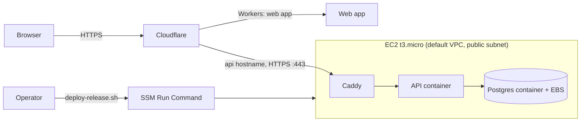

# ADR-021: Low-Cost Single-Host Deployment (EC2)

- **Status**: Accepted
- **Date**: 2026-10-10

## Context

The production deployment exists to show the project at the master's review, with a handful of users and almost no traffic. The hosting budget is effectively zero: AWS Free Plan credits that last a fixed period, after which the account closes unless upgraded.

Managed compute and database services carry fixed monthly costs (a managed database alone is roughly $13-15/month, and private networking adds a NAT Gateway at about $32/month), which do not fit this budget.

Constraints:

- Only one deployed environment; day-to-day work happens in the `local`, `test` and `container` environments ([ADR-014](./adr-014-environment-strategy.md)).
- The API image already runs migrations at start (`scripts/start-api.sh`) and needs only one instance.

## Decision

Run one `prod` environment with the smallest components that satisfy the requirements:

| Component | Choice |
| --- | --- |
| API | Docker containers on one EC2 `t3.micro`, started with Docker Compose |
| Reverse proxy | Caddy on the same host |
| Database | PostgreSQL 15 container on the same host, data on the instance's EBS volume ([ADR-004](./adr-004-database.md)) |
| Web app and edge | Cloudflare Workers and the Cloudflare proxy ([ADR-022](./adr-022-cloudflare-edge-instead-of-cloudfront.md)) |
| Image registry | Public GitHub Container Registry |
| Secrets and config | SSM Parameter Store (Standard), read by the deploy script ([ADR-011](./adr-011-secrets-management.md)) |
| Host access | SSM Session Manager and Run Command only; no SSH |
| Infrastructure as Code | Terraform in the separate `open-projects-hub-infra` repository, S3 state with native locking ([ADR-013](./adr-013-infrastructure-as-code.md)) |
| Account, region and deploys | Free Plan credits account in `us-east-2`; a person deploys a release tag with a script ([ADR-023](./adr-023-credits-account-us-east-2-manual-deploy.md)) |
| Backups | **None**, by decision |

## Consequences

### Positive

- About $12-13/month, paid from the Free Plan credits (EC2 about $7.60, public IPv4 about $3.65, EBS about $1.60). SSM and the budgets stay inside always-free allowances.
- No NAT Gateway, load balancer or managed-database charges.
- Small moving-part count: one host, one `docker compose up`.
- The `container` environment runs the same Docker image that is deployed, so it doubles as the pre-release smoke test.

### Negative

- **No backups.** If the instance or the account is lost, the data is lost. The instance has termination protection and `prevent_destroy`, but that guards only against accidents. A manual `pg_dump` over SSM is the escape hatch.
- **Single point of failure.** One host, one availability zone, no failover. A deploy briefly restarts the API.
- **Fixed lifetime.** The Free Plan ends after its fixed period or when the credits run out. After that the account must be upgraded or the system rehosted.
- **Capacity.** 1 GB of RAM (plus swap) and a 30-connection Postgres limit are sized for a handful of users.

## Architecture

Deploy flow for a release tag:

1. The API repository builds the image and pushes `ghcr.io/alonsovndev/open-projects-hub-api:<tag>`.
2. An operator runs `scripts/deploy-release.sh <tag>` with their own AWS credentials, which runs the `ophub-prod-deploy` SSM document with the tag.
3. On the host, `deploy.sh` reads `/ophub/prod/*` from SSM Parameter Store, fetches the compose file and Caddyfile for that tag, pulls images, restarts the stack and waits for `/health/ready`.
4. The web app is built and published by Cloudflare from the web repository.

## Alternatives Considered

1. **Lambda + API Gateway.** The API runs migrations at start, uses asyncpg connections and has no Lambda adapter; it would need code changes and a database reachable without a VPC.
2. **PostgreSQL on an external free tier (Neon, Supabase).** Cheapest, but moves data outside AWS and weakens the single-provider goal for compute and data.
3. **Lightsail container service.** Comparable price and no long-term credits; the EC2 route keeps everything in Terraform alongside the rest of the stack.
4. **A managed database instead of a container.** Managed backups and patching, but a fixed cost of roughly $13-15/month on top of the host, which the credits would burn faster.
