# Interface walkthrough and historical prototype

This page separates captures of the current local application from the earlier Pencil designs. Use the current implementation to inspect the interface; use the historical prototype to understand design intent and subsequent changes.

## Current implementation

The following captures show the local web working tree based on revision `6408eca`, captured on 2026-10-19 (America/Costa_Rica). Local header/footer edits were present, so these are not exact images of the committed revision. All content is fictional, and API responses were intercepted for demonstration. Environment-file loading and telemetry were disabled; external browser requests were blocked.

The approved backlog and Client Review states were staged independently. These images demonstrate the implemented presentation, not a real AI response, backend persistence, successful approval transaction, production deployment, or stakeholder acceptance.

### Refinement workspace

<figure>

[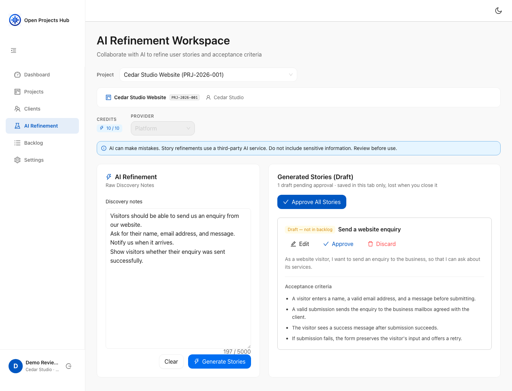](../../static/img/product/refinement-workspace.png)

<figcaption>Figure 1. A candidate story remains unapproved in the refinement workspace. The fictional story matches the reviewer guide; model output and credits are staged API responses.</figcaption>
</figure>

### Approved backlog

<figure>

[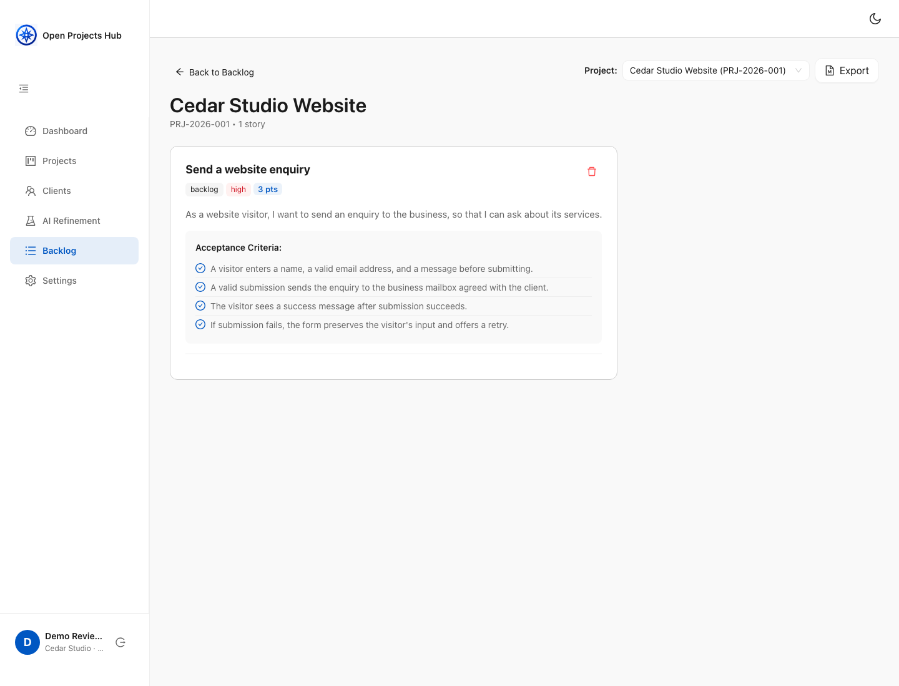](../../static/img/product/approved-backlog.png)

<figcaption>Figure 2. The same story in the authenticated project backlog. The planned/backlog lifecycle label is separate from the approval boundary: unapproved local drafts do not appear here.</figcaption>
</figure>

### Client Review

<figure>

[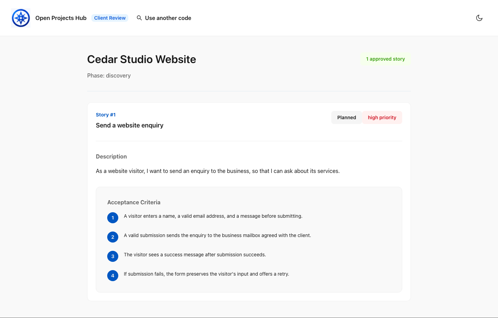](../../static/img/product/client-review.png)

<figcaption>Figure 3. The public read-only presentation of the approved story. The fixture demonstrates content layout, not authentication, access-code entropy, or backend authorization.</figcaption>
</figure>

Follow the [worked example](../00-context/reviewer-guide.md#worked-example-a-clients-contact-form) for the review decisions behind these views.

## Historical prototype

The Pencil prototype predates [ADR-020](../04-decisions/adr-020-client-review-by-access-code.md). Its original Viewer accounts, epic grouping, ambiguity highlights, and persisted-draft implications are not the current application contract. The implementation uses Admin and Member accounts, shared project access codes, project stories without persisted epics, and browser-only unapproved drafts.

The source design is preserved for traceability rather than rewritten to resemble the implementation.

## Files

| File                        | Purpose                                                                                                  |
| --------------------------- | -------------------------------------------------------------------------------------------------------- |
| `README.md`                 | This file — directory overview and quick start                                                           |
| `prototype-brief.md`        | Historical page definitions, user flows, scope, and requirements coverage matrix         |
| `design-direction.md`       | Visual direction, color strategy, typography, component inventory, accessibility, responsive breakpoints |
| `pen/open-projects-hub.pen` | Editable Pencil source with the artboards and components listed below                                |

## Opening the Prototype

The `.pen` file opens in **Pencil** — a collaborative design tool.

```bash
# File location
open-projects-hub-docs/docs/05-prototype/pen/open-projects-hub.pen
```

Open it from Pencil via **File → Open** and navigate to the path above, or use the Pencil CLI.

## Screens Preview

These 12 exports preserve the original core screens. Each image links to its full-size asset. Modal and validation-state designs remain in the Pencil file.

### Landing / Home

<figure>

[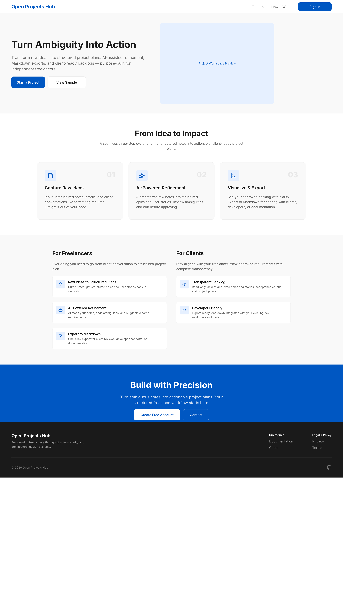](./images/02-landing-home.png)

<figcaption>Figure 4. Original centered landing composition and feature messaging; the current application has evolved.</figcaption>
</figure>

### Entry and role selection

<figure>

[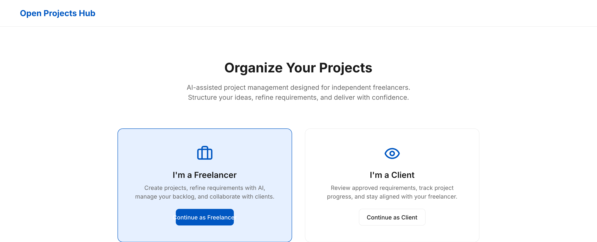](./images/01-entry-role-selection.png)

<figcaption>Figure 5. Original Admin/Viewer role choice. Viewer accounts were replaced by the account-free access-code flow.</figcaption>
</figure>

### Admin sign-up

<figure>

[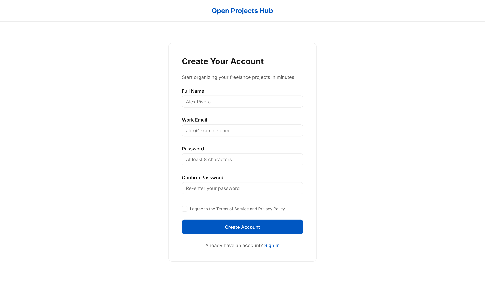](./images/03-admin-sign-up.png)

<figcaption>Figure 6. Early registration layout. Consult the current API contract for verification and duplicate-account behavior.</figcaption>
</figure>

### Admin sign-in

<figure>

[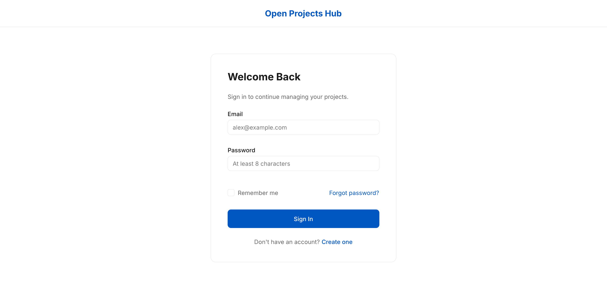](./images/04-admin-sign-in.png)

<figcaption>Figure 7. Original login form and account-entry actions; session behavior is defined by the implemented auth flow.</figcaption>
</figure>

### Forgot password

<figure>

[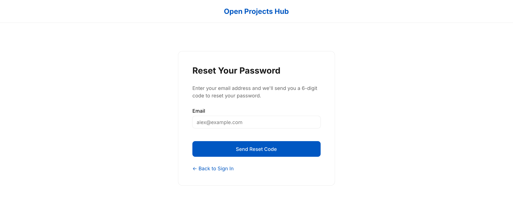](./images/05-forgot-password.png)

<figcaption>Figure 8. Early reset-request screen; the current reset-code expiry is 30 minutes.</figcaption>
</figure>

### Reset password

<figure>

[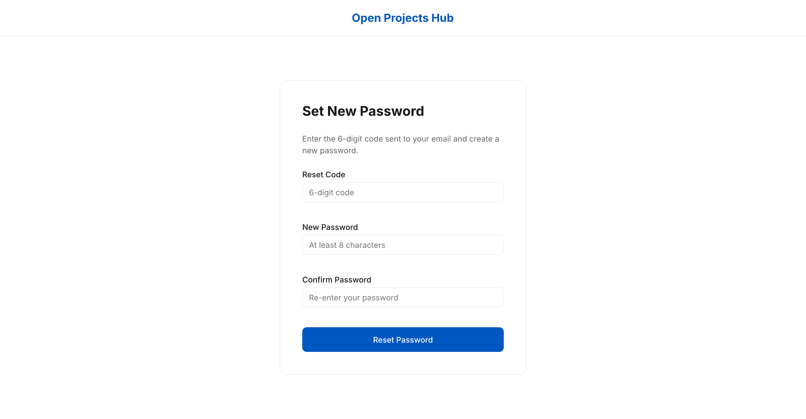](./images/06-reset-password.png)

<figcaption>Figure 9. Original code-entry and password form. Current codes are six-character alphanumeric values.</figcaption>
</figure>

### AI refinement workspace

<figure>

[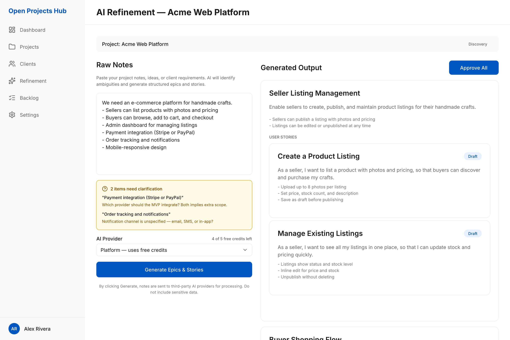](./images/07-ai-refinement-workspace.png)

<figcaption>Figure 10. Historical epic cards and ambiguity bar. The current response returns candidate stories, not an ambiguity register or persisted epic hierarchy.</figcaption>
</figure>

### Admin backlog

<figure>

[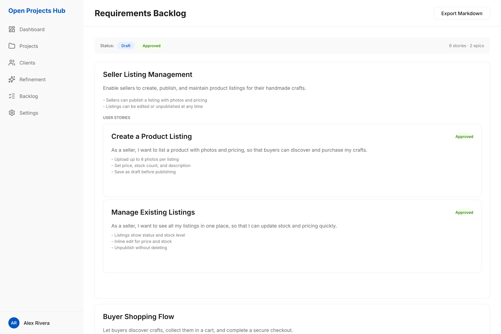](./images/08-admin-backlog.png)

<figcaption>Figure 11. Original approved-content and export layout; current stories are stored directly within a project.</figcaption>
</figure>

### Admin dashboard

<figure>

[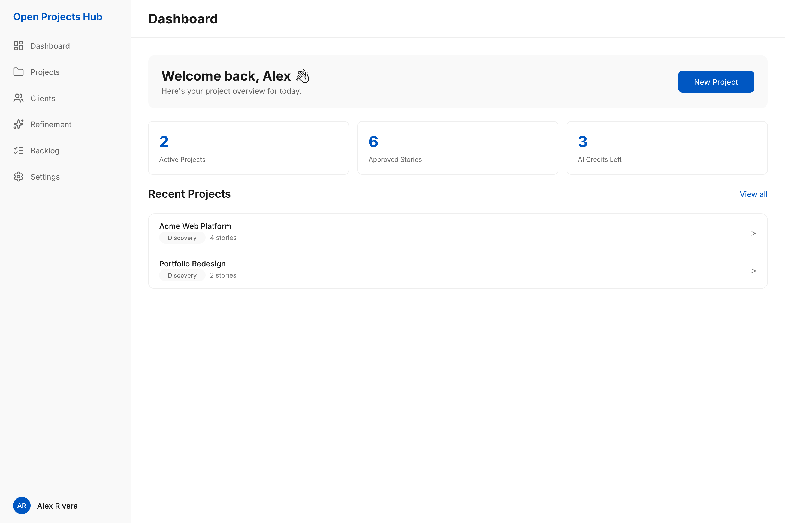](./images/09-admin-dashboard.png)

<figcaption>Figure 12. Early summary and recent-project composition. The current dashboard is not an advanced analytics system.</figcaption>
</figure>

### Admin settings

<figure>

[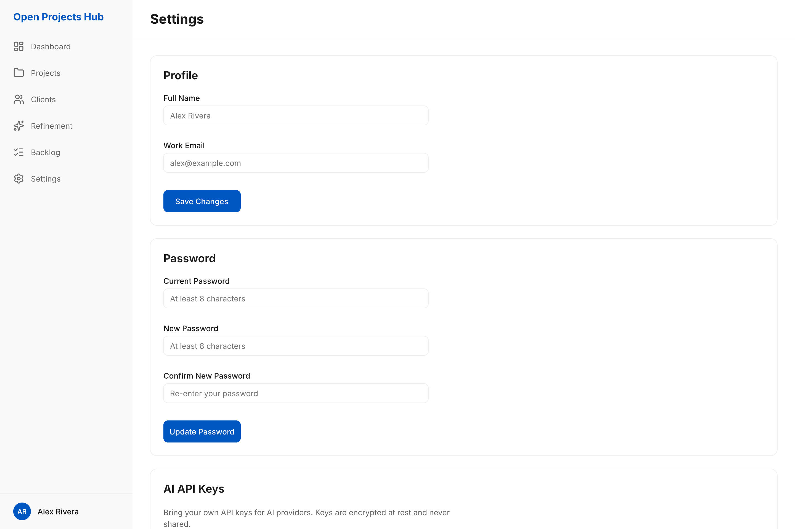](./images/10-admin-settings.png)

<figcaption>Figure 13. Original settings exploration; only implemented profile, password, provider-key, and workspace actions should be treated as available.</figcaption>
</figure>

### Viewer backlog

<figure>

[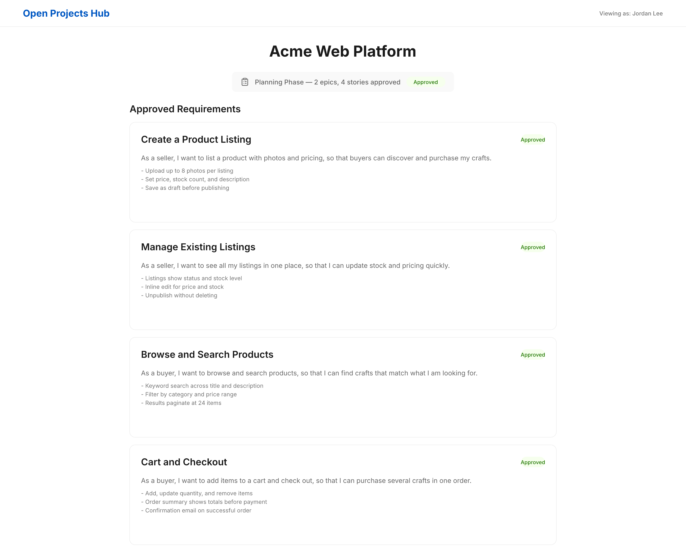](./images/11-viewer-backlog.png)

<figcaption>Figure 14. Original client-facing design. The current Client Review page uses a project code and has no Viewer account.</figcaption>
</figure>

### Onboarding overlay

<figure>

[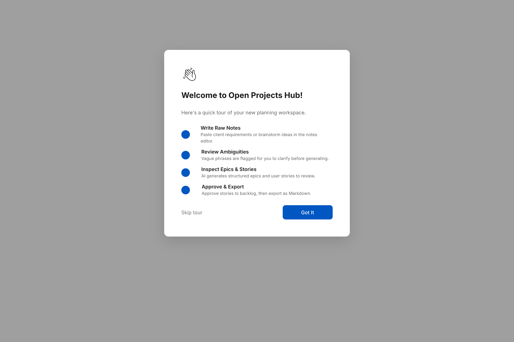](./images/12-onboarding-overlay.png)

<figcaption>Figure 15. Early onboarding design intent; this image is not evidence of completed usability or accessibility validation.</figcaption>
</figure>

## What's Inside

### 22 Artboards

| #   | Artboard                       | Layout  | Key Features                                                                                  |
| --- | ------------------------------ | ------- | --------------------------------------------------------------------------------------------- |
| 1   | Landing / Home                 | Public  | Hero, features grid, info cards, CTA section, footer                                          |
| 2   | Entry & Role Selection         | Public  | Two role cards (Admin / Viewer) with CTAs                                                     |
| 3   | Admin Sign Up                  | Public  | Registration form: name, email, password, confirm, terms                                      |
| 4   | Admin Sign In                  | Public  | Email + password, remember-me, forgot/create links                                            |
| 5   | Forgot Password                | Public  | Email capture for reset code                                                                  |
| 6   | Reset Password                 | Public  | 6-digit code + new password + confirm                                                         |
| 7   | AI Refinement Workspace        | Admin   | Split-pane: raw notes → generated epics & stories, ambiguity bar, provider + credits, approve |
| 8   | Admin Backlog                  | Admin   | Filter bar, epic + story list, Markdown export                                                |
| 9   | Admin Dashboard                | Admin   | Welcome card, stats (projects/stories/credits), recent projects list                          |
| 10  | Admin Settings                 | Admin   | Profile, password, API keys management, danger zone                                           |
| 11  | Projects                       | Admin   | Search + status/client/date filters, project rows with phase & status                         |
| 12  | New Project                    | Admin   | Name, client, phase, description, active-slot hint                                            |
| 13  | Clients                        | Admin   | Client list, search, per-row Edit + Archive-or-Delete (FR-001-04)                             |
| 14  | Viewer Backlog                 | Public  | Read-only stories with status tags, phase badge, no edit controls                             |
| 15  | Onboarding Overlay             | Overlay | 4-step welcome tour: notes, ambiguities, epics & stories, approval                            |
| 16  | Privacy Policy                 | Public  | Legal content page                                                                            |
| 17  | Terms of Service               | Public  | Legal content page                                                                            |
| 18  | Modal: Project Limit Reached   | Overlay | Blocks a 4th active project; prompts to archive (FR-001-02, FR-001-07)                        |
| 19  | Modal: Client Delete Blocked   | Overlay | Blocks deleting a client with active projects (FR-001-04)                                     |
| 20  | Modal: New Client              | Overlay | Client name + contact email, Cancel/Create                                                    |
| 21  | Projects — Empty               | Admin   | Empty state before any project exists                                                         |
| 22  | New Project — Validation Error | Admin   | Inline alert + field error state for a missing project name                                   |

### 17 Reusable Components

| Component          | Type                                                |
| ------------------ | --------------------------------------------------- |
| `Button/Primary`   | Filled blue button                                  |
| `Button/Secondary` | Outlined button                                     |
| `Tag/Draft`        | Blue-light pill                                     |
| `Tag/Approved`     | Green pill                                          |
| `Tag/Phase`        | Surface pill (Discovery/Planning)                   |
| `FormField`        | Label + bordered input                              |
| `StoryCard`        | Title + description + acceptance criteria           |
| `EpicCard`         | Title + description + criteria + nested story cards |
| `SiderNavItem`     | Icon + label navigation item                        |
| `Sider`            | Sidebar: logo, 6 nav items, user area               |
| `AdminLayout`      | 240px sider + page header + scrollable content body |
| `AmbiguityBar`     | Flagged phrases with clarification reasons          |
| `Select`           | Label + control with chevron                        |
| `Alert`            | Inline error/warning message with icon              |
| `EmptyState`       | Icon + title + description + CTA                    |
| `ListRow`          | Primary/secondary text + tags + row actions         |
| `Modal`            | Dimmed overlay + centered card with actions          |

### 47 Design Tokens

Colors (`$primary`, `$surface`, `$text-primary`, `$success`, `$warning`, `$error`, etc.), spacing scale (4px grid, 7 tiers), typography (Inter, 5 sizes, 4 weights), layout constants (sider widths, radii, shadows).

## Scope

The prototype covers the MVP **Discovery** and **Planning** workflows only. Out of scope: delivery, sprint, handoff, collaboration, and maintenance workflows.

## Source References

- [Prototype Brief](./prototype-brief.md)
- [Design Direction](./design-direction.md)
- [Project Overview](../00-context/overview.md)
- [Requirements by Feature](../01-requirements/)
- [Architecture](../03-architecture/)

Last Updated: 2026-09-09
